# VolunteerHub — Nền Tảng Kết Nối & Quản Lý Hoạt Động Thiện Nguyện (NhiLun)

[](https://nextjs.org/)
[](https://fastapi.tiangolo.com/)
[](https://supabase.com/)
[](https://www.typescriptlang.org/)
[](https://python.org/)

---

## 🌟 Giới Thiệu Tổng Quan

**VolunteerHub (NhiLun)** là nền tảng số kết nối tình nguyện viên với các tổ chức thiện nguyện trên toàn quốc. Hệ thống minh bạch hóa toàn bộ chu trình tình nguyện: từ khám phá cơ hội, nộp đơn ứng tuyển, xét duyệt hồ sơ, điểm danh tại hiện trường qua QR Code cho đến tự động tính lũy giờ cống hiến và phát hành chứng nhận điện tử có mã định danh xác thực.

---

## 🏗️ Kiến Trúc Hệ Thống (Tech Stack)

```
┌────────────────────────────────────────────────────────┐
│                   FRONTEND (Next.js 15)                │
│    App Router • Server/Client Components • Realtime     │
│    Vanilla CSS Design System • Dynamic Theme Palettes   │
└───────────────────────────┬────────────────────────────┘
                            │ REST API / JWT Session
┌───────────────────────────▼────────────────────────────┐
│                    BACKEND (FastAPI)                   │
│    Async Python • RBAC Authorization • Validation       │
│    Audit Logging • Media & Storage Handler             │
└───────────────────────────┬────────────────────────────┘
                            │ AsyncPG / PostgREST
┌───────────────────────────▼────────────────────────────┐
│                  DATABASE & AUTH (Supabase)            │
│    PostgreSQL • Row Level Security • Supabase Auth     │
│    Realtime Publications • Object Storage (Buckets)    │
└────────────────────────────────────────────────────────┘
```

---

## 📸 Giao Diện & Kịch Bản Sử Dụng (Screenshots)

### I. Cổng Công Khai (Public Portal)

#### 1. Trang Chủ (Home Page)
Giao diện tiếp đón với Hero banner truyền cảm hứng, bộ lọc tìm kiếm nhanh theo tỉnh thành/lĩnh vực, thống kê số liệu tác động cộng đồng theo thời gian thực và danh sách hoạt động nổi bật.
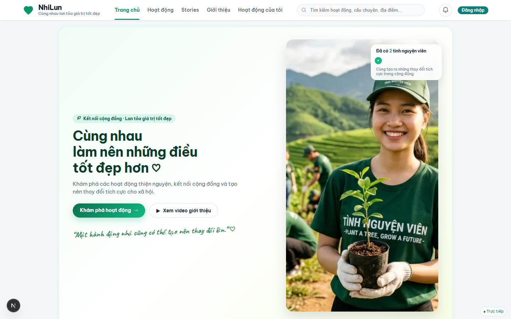

#### 2. Danh Sách Hoạt Động (Activities Catalog)
Bộ lọc đa chiều (địa bàn, danh mục môi trường, giáo dục, cứu trợ, trạng thái tuyển còn chỗ/hết hạn), hỗ trợ chế độ xem Grid / List và lưu yêu thích.
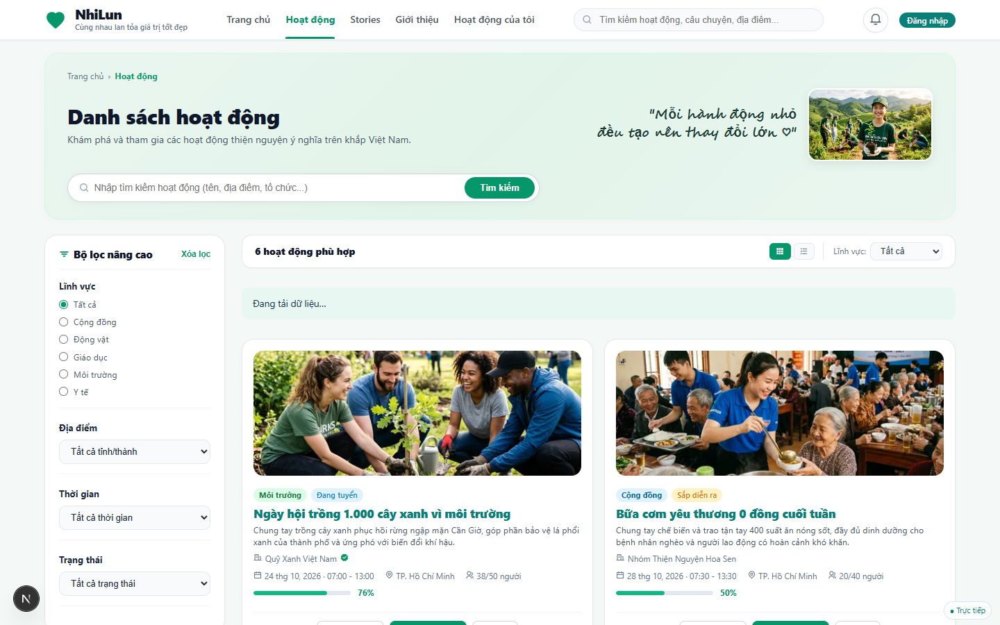

#### 3. Chi Tiết Hoạt Động (Activity Detail)
Thông tin chuyên sâu về chiến dịch: timeline lịch trình chi tiết, yêu cầu kỹ năng, vật dụng mang theo, số lượng chỉ tiêu còn lại, thông tin đơn vị tổ chức có tích xanh xác thực.
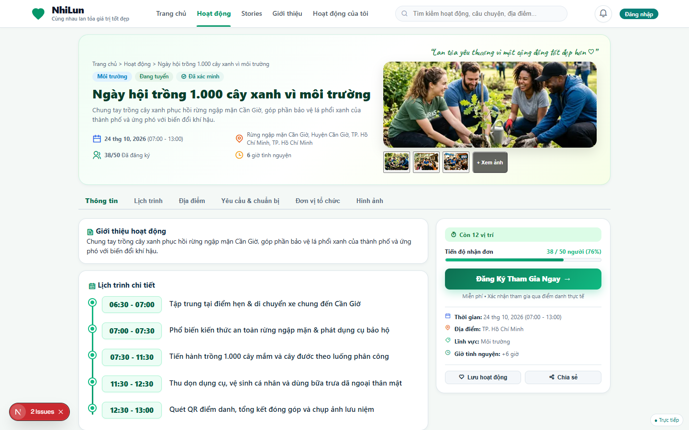

#### 4. Câu Chuyện Tình Nguyện (Community Stories)
Khu vực lan tỏa tinh thần thiện nguyện: các bài viết cảm nhận thực tế, nhật ký cống hiến và video clip phóng sự từ tình nguyện viên.
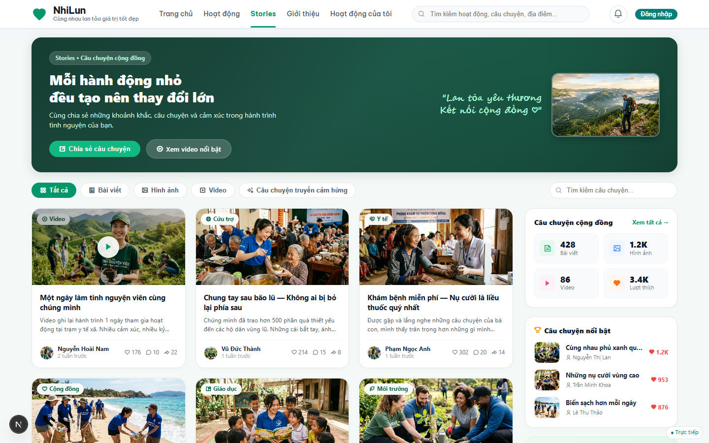

#### 5. Giới Thiệu Dự Án (About Us)
Sứ mệnh, tầm nhìn, giá trị cốt lõi và tiêu chuẩn minh bạch của nền tảng NhiLun / VolunteerHub.
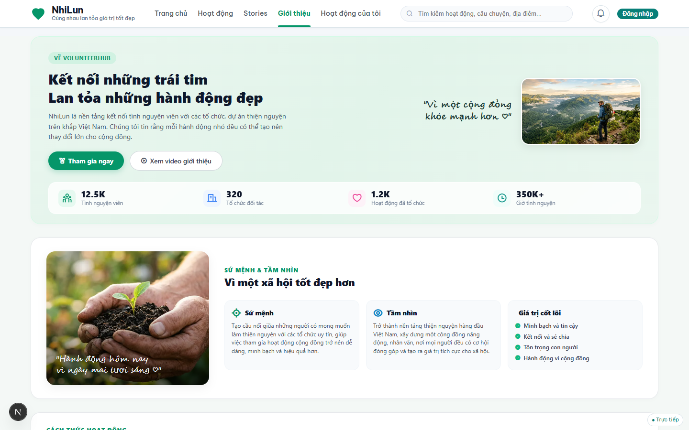

#### 6. Xác Thực Tài Khoản (Authentication)
Trang Đăng ký / Đăng nhập tích hợp Supabase Auth, hỗ trợ phân quyền tự động theo vai trò (TNV, BTC) và thanh **Đăng nhập nhanh 1 chạm (Demo Accounts)** phục vụ kiểm thử.
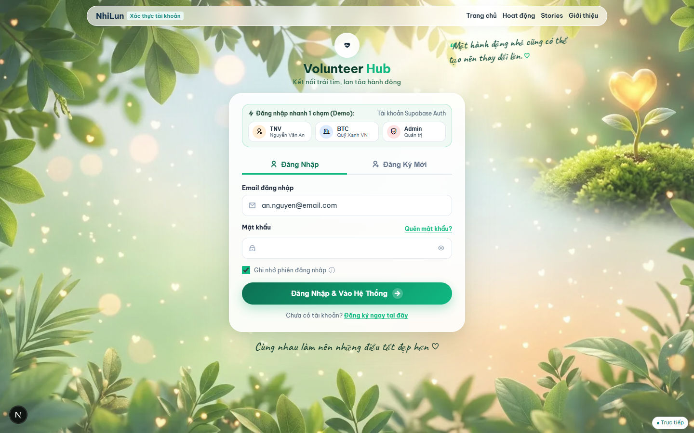

---

### II. Cổng Tình Nguyện Viên (Volunteer Portal)

#### 7. Bảng Điều Khiển Tình Nguyện Viên (Volunteer Dashboard)
Tổng quan số giờ cống hiến đã xác nhận, số hoạt động tham gia, danh mục đơn đăng ký đang chờ duyệt / đã duyệt và chứng nhận gần nhất.
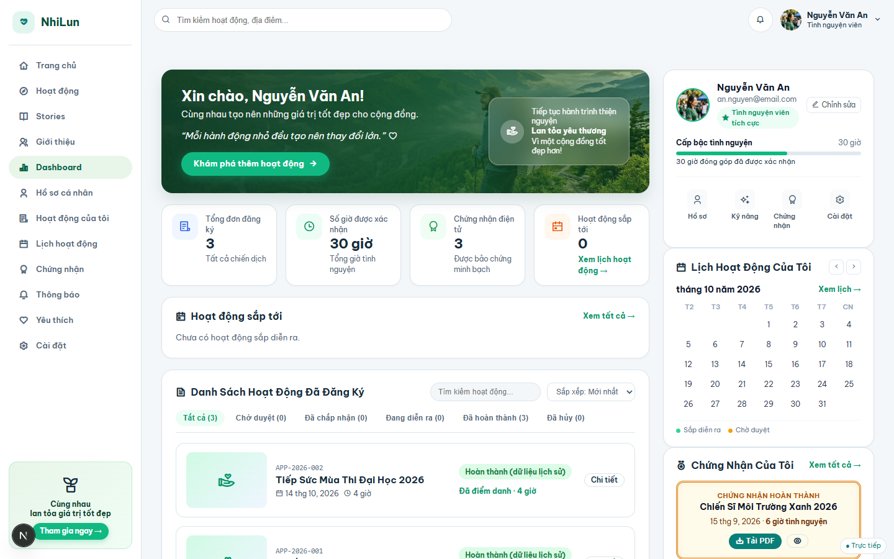

#### 8. Lịch Hoạt Động Cá Nhân (Schedule & Calendar)
Lịch trình trực quan theo tháng/tuần hiển thị các ca trực thiện nguyện đã được ban tổ chức phê duyệt tham gia.
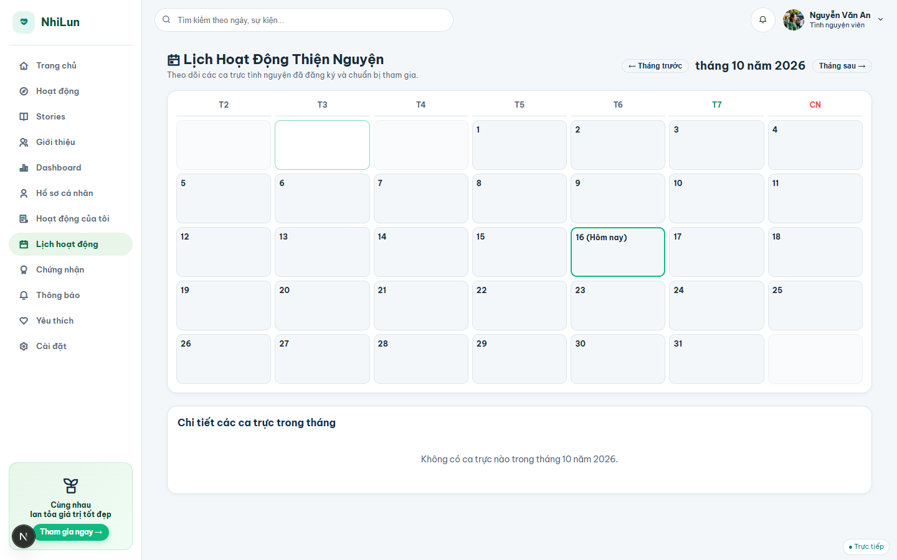

#### 9. Thư Viện Chứng Nhận Điện Tử (Certificates)
Bộ sưu tập chứng nhận điện tử chính thức được cấp sau khi hoàn thành hoạt động, tích hợp mã định danh duy nhất (`CERT-2026-XXX`) và mã QR xác thực công khai.
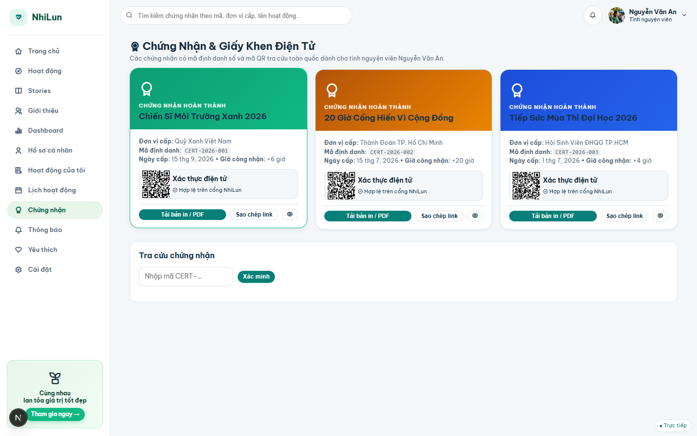

#### 10. Trung Tâm Thông Báo (Notifications)
Theo dõi trạng thái xét duyệt đơn nộp, nhắc nhở lịch trình sắp diễn ra, thông báo điểm danh thành công từ BTC.
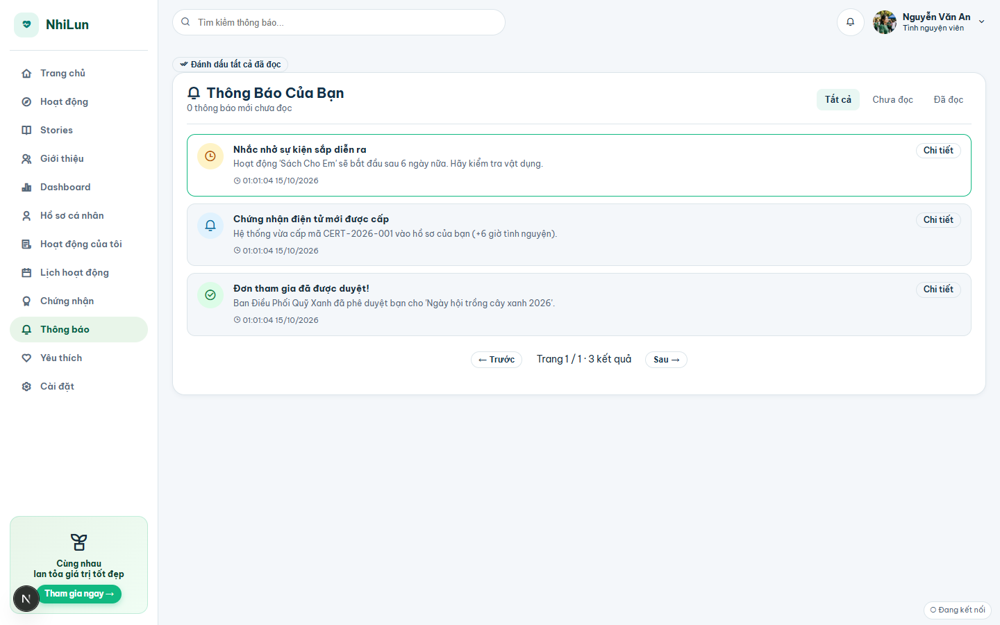

#### 11. Hồ Sơ Cá Nhân & Kỹ Năng (Profile & Settings)
Quản lý thông tin liên hệ, tiểu sử, bộ kỹ năng chuyên môn (sơ cấp cứu, ngoại ngữ, tổ chức, chụp ảnh) và đổi mật khẩu.
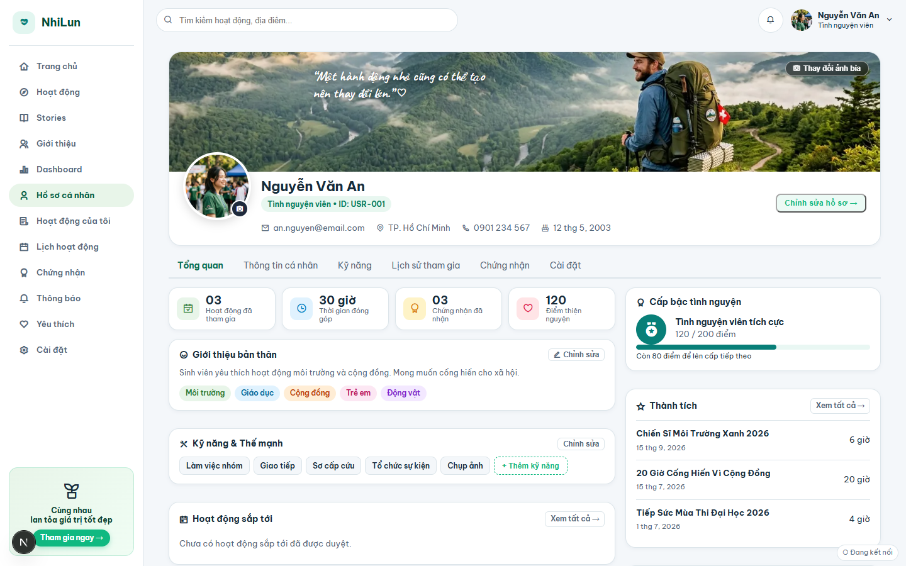

---

### III. Cổng Ban Tổ Chức (Organizer Workspace)

#### 12. Quản Lý Hoạt Động & Ứng Viên (Organizer Management)
Bảng kiểm soát danh sách ứng viên đăng ký theo từng hoạt động: Duyệt đơn, Từ chối kèm lý do, Quét mã QR điểm danh tại chỗ, kích hoạt cấp chứng nhận tức thì và xuất báo cáo CSV UTF-8.
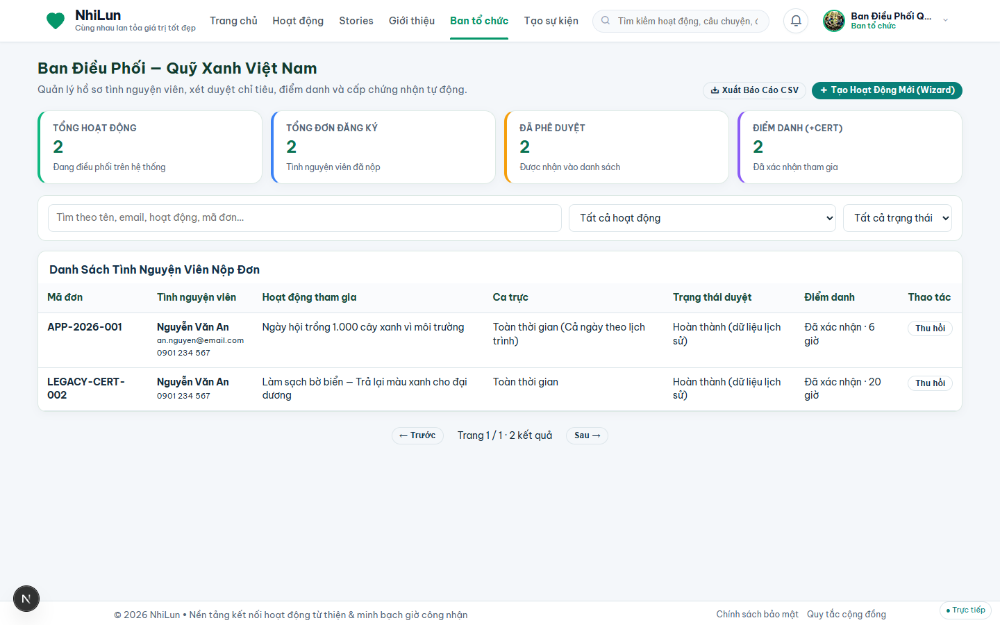

#### 13. Khởi Tạo Chiến Dịch Mới (Create Activity Wizard)
Quy trình Wizard 5 bước chuyên nghiệp: Thông tin cơ bản ➔ Thời gian & Địa điểm ➔ Chỉ tiêu & Yêu cầu ➔ Lịch trình Timeline chi tiết ➔ Xem trước & Gửi Admin duyệt.
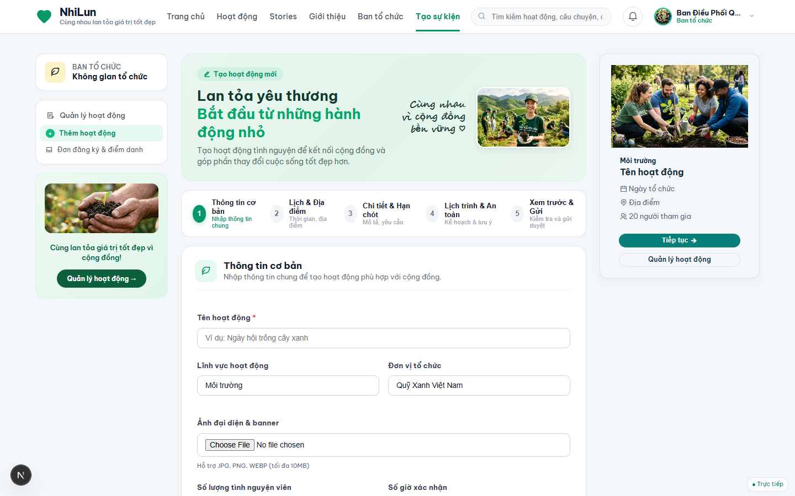

---

### IV. Cổng Quản Trị Hệ Thống (Admin Portal)

#### 14. Kiểm Duyệt Hệ Thống (Moderation & Audit Logs)
Phê duyệt pháp nhân tổ chức (cấp tích xanh xác thực), duyệt xuất bản các hoạt động ra cộng đồng và tra cứu nhật ký kiểm toán (Audit Trail) chi tiết mọi hành vi nhạy cảm.
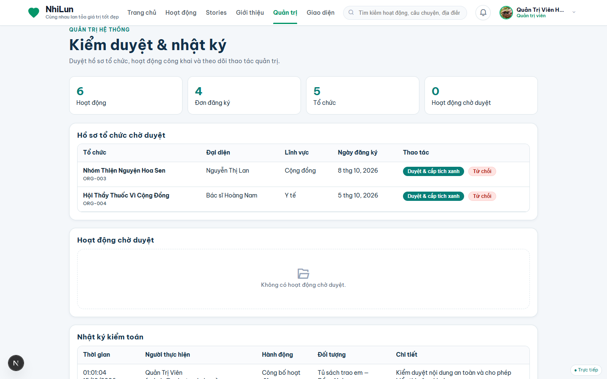

#### 15. Quản Lý Giao Diện & Bảng Màu (Dynamic Theme Settings)
Cấu hình và kích hoạt các bảng màu giao diện toàn trang theo mùa chiến dịch (Xanh Mầm Non, Cam Năng Động, Tím Cộng Đồng, Hồng Tình Nguyện) cập nhật tức thì qua CSS Variables.
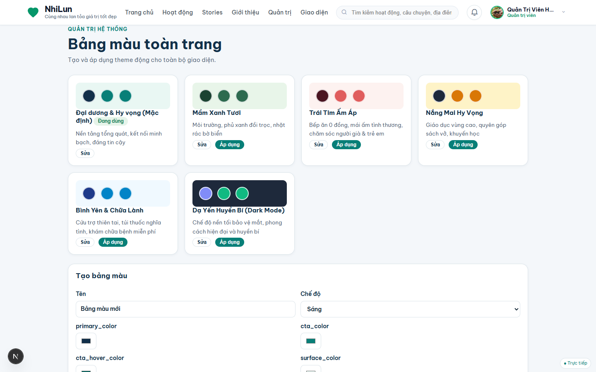

---

## 👥 Tài Khoản Kiểm Thử (Demo Accounts)

Hệ thống tích hợp sẵn nút bấm đăng nhập nhanh 1 chạm tại trang `/auth`, hoặc có thể đăng nhập bằng thông tin sau:

| Vai trò | Họ tên / Đơn vị | Email | Mật khẩu mặc định | Trang chuyển tiếp |
| :--- | :--- | :--- | :---: | :--- |
| **Tình nguyện viên (TNV)** | Nguyễn Văn An | `an.nguyen@email.com` | `123456` | `/volunteer/dashboard` |
| **Ban tổ chức (BTC)** | Quỹ Xanh Việt Nam | `coordinator@quyxanh.vn` | `123456` | `/organizer/manage` |
| **Quản trị viên (Admin)** | Quản Trị Viên Hệ Thống | `admin@volunteerhub.vn` | `123456` | `/admin/moderation` |

---

## 🚀 Hướng Dẫn Cài Đặt & Chạy Cục Bộ

### 1. Yêu Cầu Tiên Quyết
- **Node.js** v18+ & **npm**
- **Python** 3.11+
- Tài khoản và cơ sở dữ liệu **Supabase**

---

### 2. Khởi Chạy Backend (FastAPI)
```bash
cd backend
python -m venv .venv
# Trên Windows:
.venv\Scripts\activate
# Trên Linux/macOS:
source .venv/bin/activate

pip install -r requirements.txt
cp .env.example .env
# Điền thông tin SUPABASE_URL, SUPABASE_DB_URL, SUPABASE_SECRET_KEY vào .env

uvicorn app.main:app --host 127.0.0.1 --port 8000 --reload
```

---

### 3. Khởi Chạy Frontend (Next.js)
```bash
cd frontend
npm install
cp .env.example .env.local
# Cấu hình NEXT_PUBLIC_SUPABASE_URL, NEXT_PUBLIC_SUPABASE_PUBLISHABLE_KEY, NEXT_PUBLIC_API_BASE_URL

npm run dev
```

Truy cập hệ thống tại: **`http://localhost:3000`**

---

## 📁 Cấu Trúc Thư Mục Dự Án

```
WebNhiLun/
├── frontend/                     # Ứng dụng Next.js 15 (App Router)
│   ├── app/                      # Các route trang (page.tsx, layout.tsx, middleware.ts)
│   ├── components/portal/        # UI Components & Frames dùng chung
│   ├── lib/                      # Supabase client, API client, media helper
│   ├── public/legacy/            # CSS Design System & Assets tối ưu
│   └── scripts/                  # Scripts tối ưu hóa ảnh & build helpers
├── backend/                      # Dịch vụ API FastAPI (Python)
│   ├── app/                      # API router, models, schemas, auth middleware
│   ├── scripts/                  # Migration, seed dữ liệu Supabase, kiểm thử
│   └── requirements.txt          # Danh sách thư viện Python
├── supabase/                     # Quản lý Database
│   └── migrations/               # Các file schema migration PostgreSQL & RLS
├── VolunteerHub_Docs/            # Bộ tài liệu phân tích kỹ thuật & nghiệp vụ chi tiết
├── docs/screenshots/             # Bộ ảnh chụp màn hình 15 trang chức năng
├── data/                         # Dữ liệu hạt giống chuẩn hóa (seedData.js)
└── README.md                     # Tài liệu giới thiệu & hướng dẫn dự án
```

---

## 📄 Bản Quyền & Giấy Phép
Dự án được xây dựng và phát triển vì mục đích phi lợi nhuận phục vụ phong trào tình nguyện cộng đồng. Mọi đóng góp xin vui lòng tạo Pull Request hoặc liên hệ ban phát triển NhiLun.
