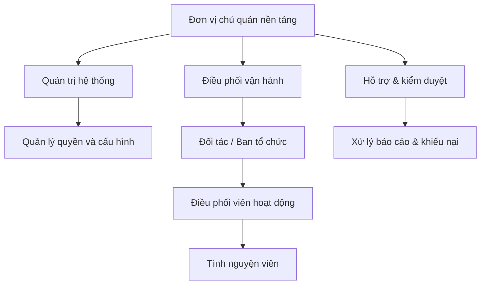
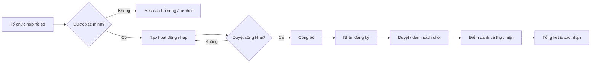

# 01 — Mô hình tổ chức & vận hành

## 1. Bản chất sản phẩm
VolunteerHub là nền tảng kết nối, không mặc định là một tổ chức từ thiện trực tiếp điều hành mọi sự kiện. Mỗi hoạt động có đơn vị chịu trách nhiệm và đầu mối liên hệ rõ ràng.

## 2. Sơ đồ tổ chức vận hành đề xuất

## 3. Vai trò nghiệp vụ
| Vai trò | Trách nhiệm | Không được làm |
|---|---|---|
| Visitor | Khám phá hoạt động công khai | Xem thông tin cá nhân người đăng ký |
| Volunteer | Quản lý hồ sơ và đơn của mình | Duyệt đơn hoặc tự điểm danh |
| Organizer Member | Quản lý hoạt động của tổ chức được phân công | Truy cập dữ liệu tổ chức khác |
| Organizer Owner | Quản lý thành viên tổ chức và hoạt động | Cấp quyền admin hệ thống |
| Moderator | Xét duyệt tổ chức, nội dung, xử lý báo cáo | Tự ý thay đổi lịch sử điểm danh |
| System Admin | Cấu hình, phân quyền, giám sát | Bỏ qua audit hoặc kiểm soát truy cập |

## 4. RACI
R=thực hiện, A=chịu trách nhiệm, C=tham vấn, I=được thông báo.
| Quy trình | Organizer | Moderator | Admin | Volunteer |
|---|---|---|---|---|
| Tạo hoạt động | R/A | I | I | - |
| Duyệt hoạt động công khai | C | R | A | - |
| Duyệt đơn tình nguyện | R/A | I | I | I |
| Điểm danh | R/A | - | I | I |
| Báo cáo vi phạm | C | R | A | R |
| Cấp chứng nhận | R | C | A (chính sách) | I |

## 5. Quy trình chính

## 6. Chính sách hoạt động
- Hoạt động phải có mục tiêu, địa điểm, lịch, số lượng, yêu cầu và liên hệ hợp lệ.
- Organizer chịu trách nhiệm tính chính xác thông tin và an toàn sự kiện.
- Nếu thay đổi thời gian/địa điểm, thông báo tới người đã đăng ký; trường hợp thay đổi lớn phải yêu cầu xác nhận lại.
- Chỉ xác nhận giờ đóng góp sau điểm danh và kiểm tra của ban tổ chức.
- Khi hủy hoạt động: ngừng đăng ký, thông báo và lưu lý do.
- Có cơ chế báo cáo hoạt động không phù hợp và kênh hỗ trợ.

## 7. KPI vận hành
Tỷ lệ xem chi tiết → đăng ký; tỷ lệ đơn được duyệt; tỷ lệ tham gia thực tế; tỷ lệ hủy; thời gian duyệt trung vị; số giờ được xác nhận; tỷ lệ hoạt động có báo cáo hoàn tất. Không dùng chỉ số số lượng làm bằng chứng tác động xã hội nếu chưa xác minh.
