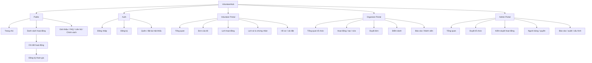

# 03 — Information Architecture, Sitemap & Routing

## Sitemap

## Route map
| Route | Quyền | Mục đích |
|---|---|---|
| `/` | Public | Landing |
| `/activities` | Public | Tìm kiếm & lọc |
| `/activities/[slug]` | Public | Chi tiết |
| `/about`, `/faq`, `/contact` | Public | Thông tin |
| `/privacy`, `/terms` | Public | Chính sách |
| `/auth/login`, `/auth/register`, `/auth/forgot-password` | Public | Auth |
| `/activities/[slug]/apply` | Volunteer | Form đăng ký |
| `/me`, `/me/applications`, `/me/calendar` | Volunteer | Dashboard |
| `/me/history`, `/me/certificates`, `/me/profile`, `/me/settings` | Volunteer | Cá nhân |
| `/organizer`, `/organizer/activities`, `/organizer/activities/new` | Organizer | Hoạt động |
| `/organizer/activities/[id]/applications` | Organizer | Duyệt đơn |
| `/organizer/activities/[id]/attendance` | Organizer | Điểm danh |
| `/organizer/reports`, `/organizer/members` | Organizer | Báo cáo, nhân sự |
| `/admin`, `/admin/organizations`, `/admin/activities` | Admin/Moderator | Kiểm duyệt |
| `/admin/users`, `/admin/reports`, `/admin/audit`, `/admin/settings` | Admin (theo quyền) | Quản trị |

## Điều hướng
Desktop public: logo trái; Hoạt động, Giới thiệu, FAQ giữa; Đăng nhập/Avatar phải. Desktop portal: sidebar 248px + topbar 64px. Mobile public: header 56px + menu; mobile volunteer: bottom nav 4 mục (Khám phá, Đơn của tôi, Lịch, Tài khoản); organizer/admin mobile dùng menu drawer, bảng chuyển thành card.

## Breadcrumb
Hoạt động > Môi trường > Ngày hội trồng cây. Organizer > Hoạt động > [Tên hoạt động] > Đơn đăng ký. Không dùng breadcrumb làm điều hướng chính trên mobile.

## State model
Event: `draft → pending_review → published → in_progress → completed`; nhánh `rejected`, `cancelled`, `archived` có lý do. Application: `pending → approved / rejected / waitlisted`; `approved → checked_in → attended`; nhánh `withdrawn`, `no_show`. Các chuyển trạng thái phải được kiểm tra theo role và điều kiện.
