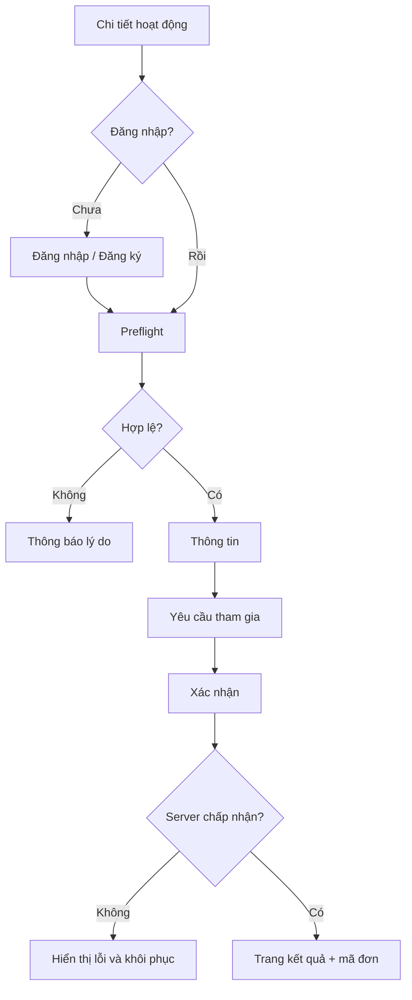

# 06 — Authentication & Registration UX

## A01 — Đăng ký tài khoản `/auth/register`
Desktop: khung form max 440px, bên cạnh panel giá trị cộng đồng (không gây áp lực). Mobile: 1 cột, không yêu cầu ảnh chân dung. Field: họ tên hiển thị, email, mật khẩu, xác nhận điều khoản; xác thực email. Có thể thêm số điện thoại sau khi cần liên hệ cho sự kiện. Không thu ngày sinh nếu không cần.
Validation inline: email đúng định dạng, mật khẩu theo chính sách, lỗi không tiết lộ tài khoản tồn tại nếu có nguy cơ enumeration; link đăng nhập. Success: hướng dẫn kiểm tra email, gửi lại có cooldown.

## A02 — Đăng nhập `/auth/login`
Email + mật khẩu, show/hide, quên mật khẩu, thông báo lỗi chung, remember session theo chính sách; redirect về trang định truy cập sau login. Throttle chống brute force. Đăng xuất khỏi thiết bị dùng chung.

## A03 — Quên mật khẩu
Nhập email → thông báo trung lập → link có thời hạn → đặt mật khẩu mới → xác nhận; không hiển thị tài khoản có tồn tại hay không.

## R01 — Đăng ký hoạt động `/activities/[slug]/apply`
**Bước 0 preflight:** đăng nhập; event published, còn hạn, còn suất hoặc waitlist; chưa đăng ký trùng; thỏa điều kiện tham gia. Kiểm tra lại ở server khi submit.
**Bước 1 Liên hệ:** họ tên từ hồ sơ, email, điện thoại (nếu sự kiện cần), liên hệ khẩn cấp chỉ nếu có lý do an toàn cụ thể và chính sách lưu trữ.
**Bước 2 Phù hợp:** câu hỏi bổ sung do organizer cấu hình nhưng phải giới hạn, không hỏi dữ liệu nhạy cảm không cần thiết; chọn ca tham gia nếu có; checkbox xác nhận đã đọc yêu cầu.
**Bước 3 Xác nhận:** summary, thông tin hoạt động, quyền hủy, mục đích sử dụng dữ liệu; CTA "Gửi đăng ký".
**Bước 4 Kết quả:** mã đơn, trạng thái `pending` hoặc `approved` nếu auto-approve, nút "Xem đơn"; gửi email/in-app notification.

## Kịch bản lỗi
- Hết chỗ trong lúc submit: HTTP 409, giải thích rõ và đề nghị waitlist nếu hỗ trợ.
- Trùng đăng ký: mở đơn hiện có, không tạo thêm.
- Hết hạn: thông báo deadline đã qua, trở lại danh sách.
- Mất mạng: giữ dữ liệu form trên thiết bị trong phiên, cho thử lại; không khẳng định thành công.
- Double click: disable submit khi pending + idempotency key ở API.
- Người chưa đủ điều kiện theo yêu cầu sự kiện: thông báo rõ và gợi ý hoạt động phù hợp, không tự động thu thêm dữ liệu cá nhân.

## Wireflow

