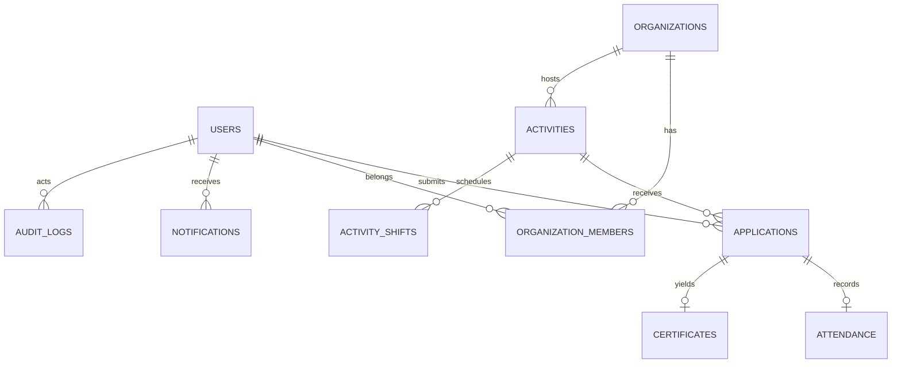

# 10 — Data Model, ERD & API Contract

## Kiến trúc
Next.js + TypeScript + Tailwind/shadcn; API Next.js hoặc NestJS; PostgreSQL; Supabase Auth/Auth.js (chọn một), object storage private/public phân tách; email worker/queue. Sử dụng server-side RBAC, không tin role từ client.

## ERD rút gọn


## Bảng dữ liệu chính
| Table | Cột cốt lõi |
|---|---|
| users | id UUID PK, auth_id UNIQUE, display_name, email, phone_nullable, status, created_at |
| organizations | id, name, description, verification_status, owner_user_id, created_at |
| organization_members | id, organization_id, user_id, role, invited_at, accepted_at; UNIQUE(org,user) |
| activities | id, organization_id, slug UNIQUE, title, description, category_id, start_at, end_at, deadline_at, timezone, location, capacity, status, version |
| activity_shifts | id, activity_id, start_at, end_at, capacity |
| applications | id, activity_id, user_id, shift_id nullable, status, answers JSONB validated, applied_at, reviewed_by, reviewed_at; UNIQUE(activity_id,user_id) theo chính sách |
| attendance | id, application_id UNIQUE, checkin_at, checkout_at, verified_minutes, verified_by |
| certificates | id, application_id UNIQUE, certificate_code UNIQUE, issued_at, document_path |
| notifications | id, user_id, type, payload JSONB, read_at, sent_at |
| audit_logs | id, actor_id, action, entity_type, entity_id, before_json, after_json, created_at, request_id |
| reports | id, reporter_id, target_type, target_id, reason, status, assigned_to |

## Quy tắc toàn vẹn
- `end_at > start_at`, `deadline_at <= start_at` theo policy (ngoại lệ có chủ đích).
- Capacity >= 0; duyệt chỗ trong DB transaction với lock, tránh race condition.
- Idempotency key cho tạo đơn và các mutation quan trọng.
- Chỉ đơn approved/checked_in/attended mới đủ điều kiện ghi attendance theo workflow.
- `verified_minutes` do server tính/duyệt, không tin input client.
- Soft delete cho entity cần audit, có retention policy và quy trình xóa dữ liệu phù hợp.

## API v1 đề xuất
| Method | Endpoint | Quyền | Chức năng |
|---|---|---|---|
| GET | `/api/v1/activities` | Public | Search, filter, paginate |
| GET | `/api/v1/activities/:slug` | Public | Detail |
| POST | `/api/v1/activities/:id/applications` | Volunteer | Đăng ký |
| GET | `/api/v1/me/applications` | Volunteer | Đơn của tôi |
| POST | `/api/v1/me/applications/:id/withdraw` | Owner | Hủy đơn |
| GET/PATCH | `/api/v1/me/profile` | User | Hồ sơ |
| POST | `/api/v1/organizer/activities` | Organizer | Tạo nháp |
| PATCH | `/api/v1/organizer/activities/:id` | Scoped Organizer | Chỉnh sửa |
| POST | `/api/v1/organizer/activities/:id/submit` | Scoped Organizer | Gửi duyệt |
| GET | `/api/v1/organizer/activities/:id/applications` | Scoped Organizer | Danh sách đơn |
| POST | `/api/v1/organizer/applications/:id/decision` | Scoped Organizer | Duyệt/từ chối |
| POST | `/api/v1/organizer/applications/:id/checkin` | Check-in staff | Điểm danh |
| POST | `/api/v1/admin/organizations/:id/decision` | Moderator/Admin | Xác minh |
| POST | `/api/v1/admin/activities/:id/decision` | Moderator/Admin | Duyệt công khai |
| GET | `/api/v1/admin/audit` | Admin | Audit |

## Response format
```json
{"data":{"id":"uuid","status":"pending"},"meta":{"requestId":"uuid"}}
```
Lỗi chuẩn: `{ "error": { "code": "CAPACITY_FULL", "message": "Hoạt động đã đủ người", "fieldErrors": {} }, "meta": { "requestId": "uuid" } }`. HTTP: 400 validation, 401 unauthenticated, 403 forbidden, 404 not found, 409 conflict, 422 business rule, 429 rate limit, 500 server.

## Nonfunctional
Pagination cursor hoặc page/limit giới hạn; index trên status/start_at/category/org; backup và restore drill; migration versioned; background jobs gửi mail retry có idempotency; metrics và tracing không log PII.
