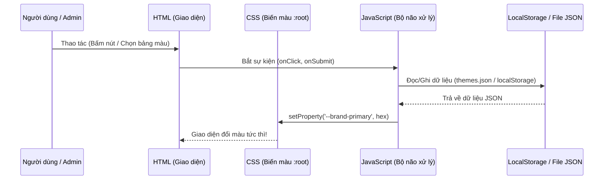

# 14 — Kịch bản các Luồng nghiệp vụ & Hướng dẫn Thuyết trình

Tài liệu này hệ thống hóa toàn bộ dự án thành **4 Luồng (Flows) độc lập, trực quan**, giúp dễ dàng theo dõi, đọc hiểu logic và phục vụ việc làm slide/thuyết trình bảo vệ đồ án.

---

## TỔNG QUAN 4 LUỒNG CHỦ CHỐT CỦA HỆ THỐNG

```mermaid
flowchart TD
    subgraph L1 [Luồng 1: Tình nguyện viên]
        A1[Khám phá hoạt động] --> A2[Nộp đơn đăng ký] --> A3[Điểm danh & Nhận chứng nhận]
    end
    subgraph L2 [Luồng 2: Ban tổ chức]
        B1[Tạo hoạt động] --> B2[Xét duyệt đơn] --> B3[Điểm danh & Xác nhận giờ]
    end
    subgraph L3 [Luồng 3: Quản trị Admin]
        C1[Kiểm duyệt sự kiện/tổ chức] --> C2[Đổi Theme & Cấu hình] --> C3[Audit Log & Giám sát]
    end
    subgraph L4 [Luồng 4: Luồng Kỹ thuật & Dữ liệu]
        D1[HTML dựng khung] --> D2[CSS biến đổi màu] --> D3[JS xử lý sự kiện & JSON/LocalStorage]
    end
```

---

## LUỒNG 1: TÌNH NGUYỆN VIÊN (Volunteer Journey)
*Mục đích thuyết trình: Minh họa trải nghiệm mượt mà, minh bạch, nhanh chóng của người tham gia.*

### 5 bước thực hiện:
1. **Khám phá & Bộ lọc (`/activities`):**
   * Người dùng tìm kiếm theo từ khóa, lọc theo: Ngày diễn ra, Tỉnh/Thành phố, Lĩnh vực (Môi trường, Giáo dục, v.v.).
   * Bộ lọc tự động lưu trên URL (`?category=moi-truong&city=hcm`) giúp chia sẻ và back/forward tiện lợi.
2. **Đánh giá chi tiết (`/activities/[slug]`):**
   * Xem mục tiêu, lịch trình, số chỗ còn lại, thông tin an toàn và yêu cầu chuẩn bị.
3. **Nộp đơn đăng ký (`/apply`):**
   * Form 4 bước rõ ràng: Preflight (kiểm tra còn chỗ) ➔ Điền liên hệ ➔ Trả lời câu hỏi bắt buộc ➔ Xác nhận điều khoản.
   * Chặn click đúp và chống trùng lặp đơn.
4. **Theo dõi trạng thái (`/me/applications`):**
   * Đơn ở trạng thái `pending` (Chờ duyệt) ➔ nhận thông báo khi được `approved` (Đã duyệt) hoặc chuyển sang danh sách chờ (`waitlisted`).
   * Tự động đồng bộ vào lịch cá nhân (`/me/calendar`).
5. **Tham gia & Xác nhận giờ cống hiến (`/me/history` & `/me/certificates`):**
   * Đến sự kiện quét mã QR điểm danh.
   * Sau sự kiện: Hệ thống cấp chứng nhận điện tử (mã kiểm tra duy nhất) và ghi nhận số giờ tình nguyện chính thức.

> **💡 Câu thoại khi thuyết trình:** *"Về phía Tình nguyện viên, hệ thống tối ưu hóa từ lúc tìm kiếm đến khi nhận chứng nhận. Điểm mấu chốt là số giờ đóng góp chỉ được hệ thống ghi nhận khi TNV thực sự đến tham gia và được ban tổ chức quét mã điểm danh, đảm bảo tính trung thực tuyệt đối."*

---

## LUỒNG 2: BAN TỔ CHỨC (Organizer Flow)
*Mục đích thuyết trình: Minh họa công cụ chuyển đổi số thay thế việc quản lý thủ công qua Excel.*

### 5 bước thực hiện:
1. **Đăng ký tổ chức (`/organizer`):**
   * Khai báo thông tin pháp nhân, sứ mệnh, giấy phép (nếu có) để Admin xét duyệt.
2. **Tạo hoạt động mới (`/organizer/activities/new`):**
   * Wizard 5 bước: (1) Thông tin chung ➔ (2) Thời gian & Địa điểm ➔ (3) Chỉ tiêu số lượng ➔ (4) Hướng dẫn an toàn ➔ (5) Xem trước & Gửi duyệt.
   * Tự động lưu bản nháp (`draft`) để tránh mất dữ liệu.
3. **Quản lý & Duyệt đơn đăng ký (`/organizer/activities/[id]/applications`):**
   * Xem danh sách ứng viên, thông tin liên hệ và câu trả lời.
   * Duyệt đơn đơn lẻ hoặc hàng loạt; khi từ chối bắt buộc nhập lý do minh bạch cho ứng viên.
   * Khóa số lượng tự động khi đã đủ chỉ tiêu (Capacity Lock).
4. **Điểm danh tại sự kiện (`/organizer/activities/[id]/attendance`):**
   * Hỗ trợ 2 hình thức: Quét mã QR token ngắn hạn (chống gian lận) hoặc tích chọn thủ công.
5. **Tổng kết & Đề xuất cấp chứng nhận:**
   * Ban tổ chức xác nhận số giờ tham gia thực tế để hệ thống phát hành chứng chỉ PDF cho TNV.

> **💡 Câu thoại khi thuyết trình:** *"Trước đây ban tổ chức quản lý bằng file Excel rất dễ trùng sót. VolunteerHub giải quyết triệt để bằng luồng duyệt tự động chặn vượt chỉ tiêu và công cụ điểm danh QR tại chỗ, tiết kiệm 80% thời gian vận hành."*

---

## LUỒNG 3: QUẢN TRỊ VIÊN & KIỂM DUYỆT (Admin Portal)
*Mục đích thuyết trình: Thể hiện tính an toàn, bảo mật và khả năng quản lý toàn diện nền tảng.*

### 4 bước thực hiện:
1. **Kiểm duyệt hai tầng (Moderation Queue):**
   * Tầng 1: Duyệt danh tính Tổ chức (`/admin/organizations`).
   * Tầng 2: Duyệt từng Hoạt động trước khi được công khai lên trang chủ (`/admin/activities`).
2. **Xử lý Báo cáo vi phạm (`/admin/reports`):**
   * Tiếp nhận các phản hồi/khiếu nại từ cộng đồng để tạm khóa hoặc gỡ bỏ sự kiện có dấu hiệu gian lận.
3. **Cấu hình Hệ thống & Đổi Theme nhanh (`/admin/settings`):**
   * Quản lý bảng màu website (CRUD: Thêm bảng màu mới, chỉnh sửa màu sắc, xóa theme tùy biến).
   * Đổi theme trực tiếp chỉ với 1 click, toàn bộ giao diện cập nhật ngay lập tức.
4. **Nhật ký kiểm toán (Audit Logs - `/admin/audit`):**
   * Ghi nhận lịch sử bất biến: Ai duyệt, duyệt lúc nào, thay đổi những dữ liệu gì để phục vụ tra cứu khi có sự cố.

> **💡 Câu thoại khi thuyết trình:** *"Admin đóng vai trò người gác cổng tin cậy. Nền tảng có cơ chế kiểm duyệt chặt chẽ và audit log bất biến. Đặc biệt, Admin có thể thay đổi linh hoạt bộ nhận diện màu sắc của website phù hợp với từng mùa chiến dịch mà không cần can thiệp code."*

---

## LUỒNG 4: KIẾN TRÚC KỸ THUẬT & LUỒNG DỮ LIỆU (Technical Flow)
*Mục đích thuyết trình: Trả lời câu hỏi của hội đồng/thầy cô về cấu trúc code, cách các công nghệ kết nối với nhau.*

### Cách giải thích cấu trúc code ngắn gọn, thuyết phục:
1. **Frontend (Giao diện):**
   * **HTML:** Xây dựng khung các thẻ ngữ nghĩa chuẩn SEO (`<header>`, `<main>`, `<section>`, `<table>`, `<form>`).
   * **CSS thuần (Vanilla CSS):** Không phụ thuộc thư viện nặng, sử dụng **CSS Variables** (`--brand-primary`, `--brand-cta`, `--brand-surface`) để hỗ trợ đa chủ đề (Multi-theme).
2. **Logic & Quản lý trạng thái:**
   * **JavaScript (Vanilla JS):** Đảm nhiệm việc lắng nghe sự kiện người dùng, kiểm tra hợp lệ dữ liệu (Validation), thực hiện các thao tác Thêm/Sửa/Xóa.
   * **Lưu trữ dữ liệu:** Giai đoạn hiện tại sử dụng `localStorage` và file định dạng **JSON** để giả lập Backend. Dữ liệu không bị mất khi F5 trình duyệt.
3. **Khả năng mở rộng Backend (C# / Java / Python):**
   * Thiết kế dữ liệu theo chuẩn RESTful API. Khi tích hợp Backend, chỉ cần thay việc đọc file JSON bằng hàm `fetch('/api/v1/...')` mà không phải viết lại giao diện Frontend.

> **💡 Câu thoại khi thuyết trình:** *"Về mặt kiến trúc kỹ thuật, em áp dụng mô hình phân tách rõ ràng: HTML dựng cấu trúc, CSS quản lý biến màu động, và JavaScript xử lý logic thao tác dữ liệu dạng JSON. Kiến trúc này giúp mã nguồn sáng sủa, hiệu năng cao và rất dễ dàng cắm nối vào Backend ASP.NET C# hay Spring Boot Java sau này."*

---

## LUỒNG 5: XÁC THỰC, PHÂN QUYỀN (RBAC) & DASHBOARD ĐIỀU HÀNH
*Mục đích thuyết trình: Minh họa tính năng bảo mật, phân luồng vai trò rõ ràng và trung tâm điều hành toàn diện.*

### Các tính năng nổi bật:
1. **Trang Xác thực Tài khoản (`/auth.html`):**
   - Hỗ trợ **Đăng nhập & Đăng ký** với phân loại vai trò trực quan (`🙋 Tình nguyện viên cá nhân` / `🏢 Ban tổ chức / CLB`).
   - Cung cấp **3 nút Đăng nhập nhanh 1 chạm (Quick Demo)** cho giám khảo/thầy cô chấm điểm:
     - 🙋 TNV: `an.nguyen@email.com` ➔ Tự động điều hướng đến Trang cá nhân TNV.
     - 🏢 BTC: `coordinator@quyxanh.vn` ➔ Tự động điều hướng đến Trang quản lý duyệt đơn & tạo sự kiện.
     - 🛡️ Admin: `admin@volunteerhub.vn` ➔ Tự động điều hướng đến Dashboard & Hàng đợi kiểm duyệt.
2. **Bảng Điều Khiển Tổng Quan (`/dashboard.html`):**
   - Giám sát 4 chỉ số KPI điều hành: Số lượng TNV, Tổ chức bảo chứng, Chiến dịch đang mở, Tổng giờ thiện nguyện thực tế.
   - Biểu đồ cơ cấu lĩnh vực hoạt động & Tỷ lệ hoàn thành chỉ tiêu tuyển quân (CSS-powered).
   - Bộ lọc ma trận hành động theo từng vai trò (Role Actions Matrix).
   - Dòng nhật ký thời gian thực (Realtime Audit Stream).
3. **Tạo Hoạt động với Nhiều Địa điểm & Lịch Themed (`/organizer/create-event.html`):**
   - Hỗ trợ thêm linh hoạt nhiều trạm dừng / địa điểm trao quà bên cạnh điểm tập kết chính.
   - Popup Lịch Themed tùy chỉnh đẹp mắt, phím tắt chọn nhanh hạn chót (+3 ngày, +1 tuần, trước sự kiện 3 ngày).
4. **Gợi ý Màu Chế độ Tối Thông minh (`/admin/theme-settings.html`):**
   - Thuật toán chuyển đổi HSL tự động gợi ý bộ màu Tối tương phản cao, thẻ bài và tiêu đề sáng rõ nét, không bị tối đen.

