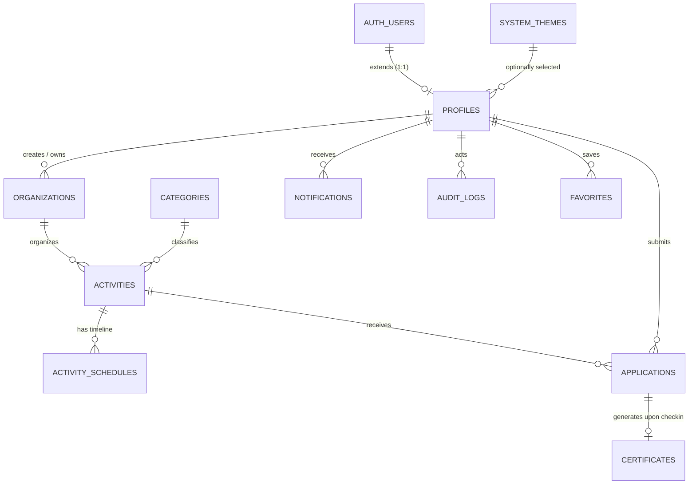
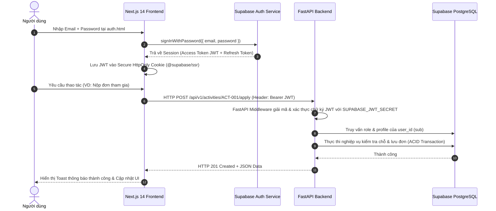
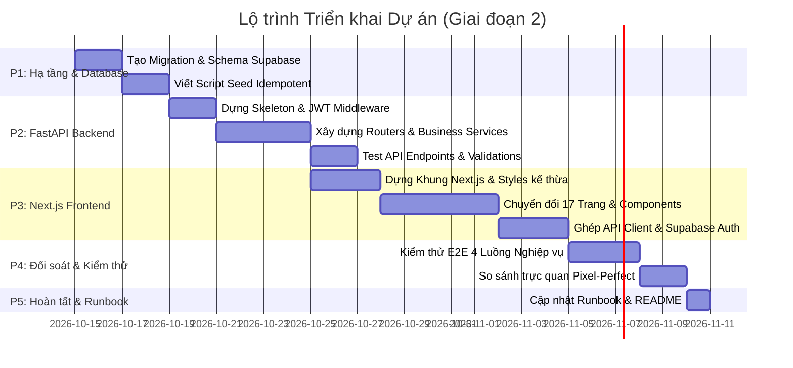

# BLUEPRINT NÂNG CẤP KIẾN TRÚC TOÀN DIỆN: NEXT.JS + FASTAPI + SUPABASE
## Dự án: VolunteerHub / NhiLun (Cổng Kết Nối & Quản Lý Hoạt Động Tình Nguyện)

---

## 1. KHẢO SÁT HIỆN TRẠNG HỆ THỐNG (AS-IS AUDIT)

### 1.1. Danh mục 17 Trang, Layout và Chức năng

| STT | Trang / Tệp nguồn | Layout & Cấu trúc chính | Chức năng nghiệp vụ hiện có | Quyền truy cập |
|:---:|:---|:---|:---|:---:|
| 1 | `index.html` (Trang chủ) | Navbar, Hero Banner, Stats Ticker, Featured Activities Grid, Stories Highlights, CTA, Footer | Tìm kiếm nhanh theo từ khóa/tỉnh/chuyên mục; xem chỉ số tác động cộng đồng; xem sự kiện tiêu biểu | Public |
| 2 | `activities.html` (Danh sách hoạt động) | Search bar, Filter Sidebar (Desktop) / Filter Popup Bottom Sheet (Mobile), Activity Cards Grid, Pagination | Tìm kiếm, bộ lọc đa chiều (lĩnh vực, địa phương, trạng thái tuyển), lưu yêu thích (favorite toggle), xem nhanh tình trạng chỗ trống | Public |
| 3 | `detail.html` (Chi tiết sự kiện) | Hero Banner, Meta Badges, Lịch trình Timeline, Yêu cầu & Vật dụng, Khung đăng ký CTA, Thẻ đơn vị tổ chức (tích xanh) | Đọc thông tin chi tiết, kiểm tra hạn đăng ký, điều kiện tham gia, chuyển tiếp sang trang nộp đơn `apply.html`, chia sẻ mạng xã hội | Public |
| 4 | `volunteer/apply.html` (Nộp đơn tham gia) | Preflight Activity Card, 4-step Registration Form, Điều khoản cam kết | Kiểm tra tính khả dụng (sự kiện còn chỗ, chưa hết hạn); form điền ca trực, kỹ năng, kinh nghiệm; chặn gửi trùng lặp; gửi đơn `pending` | Volunteer (Cần đăng nhập) |
| 5 | `dashboard.html` / `volunteer/dashboard.html` | Sidebar/Topbar, 3 KPI Stats Cards, Tab filter đơn (Tất cả, Chờ duyệt, Đã duyệt, Từ chối, Đã hủy), Mini Calendar, Cert Carousel, Notif feed | Quản lý lịch sử nộp đơn cá nhân; hủy đơn (nếu chưa diễn ra); xem tiến độ tích lũy giờ tình nguyện và chứng nhận | Volunteer |
| 6 | `schedule.html` (Lịch hoạt động cá nhân) | Month/Week View Calendar, Danh sách sự kiện sắp diễn ra | Xem lịch trực theo thời gian thực của các hoạt động đã được BTC phê duyệt (`approved`) | Volunteer |
| 7 | `certificates.html` (Chứng nhận điện tử) | Certificate Grid, QR Verification Badge, Modal xem/in/tải chứng nhận | Hiển thị chứng nhận chính thức (Mã số duy nhất `CERT-2026-XXX`, số giờ xác nhận, người cấp, ngày cấp, QR xác thực); tải chứng nhận | Volunteer / Public (tra cứu QR) |
| 8 | `notifications.html` (Trung tâm thông báo) | Notification List, Tab Đã đọc/Chưa đọc, Phân loại icon màu (Thành công, Nhắc nhở, Cảnh báo) | Nhận thông báo xét duyệt đơn, điểm danh, phát hành chứng nhận, sự kiện sắp tới; đánh dấu đã đọc | Authenticated |
| 9 | `profile.html` (Hồ sơ & Cài đặt) | Personal Bio Card, Skill Tags, Edit Profile Modal, Cài đặt mật khẩu & thông báo | Cập nhật họ tên, SĐT, ngày sinh, tỉnh thành, kỹ năng, tiểu sử cá nhân; mô phỏng đổi ảnh đại diện | Authenticated |
| 10 | `organizer/manage.html` (Quản trị BTC) | Campaign Selector, KPI Summary, Tab Danh sách ứng viên (Duyệt/Từ chối), Tab Quét QR Điểm danh, Export CSV | Xét duyệt hồ sơ TNV; từ chối kèm lý do; điểm danh tại chỗ qua QR/toggle; tự động kích hoạt cấp chứng nhận và tính giờ; xuất file CSV | Organizer |
| 11 | `organizer/create-event.html` (Tạo hoạt động mới) | Wizard 5 bước (Thông tin cơ bản, Thời gian - Địa điểm, Chỉ tiêu - Yêu cầu, Lịch trình chi tiết, Xem trước & Gửi duyệt) | Tạo bản nháp sự kiện; cấu hình lịch trình timeline; tải banner; gửi lên quản trị viên Admin để xét duyệt công khai | Organizer |
| 12 | `admin/moderation.html` (Kiểm duyệt hệ thống) | 4 KPI Metrics, Tab 1: Duyệt Pháp nhân Tổ chức, Tab 2: Duyệt Hoạt động công khai, Tab 3: Nhật ký kiểm toán (Audit Logs) | Cấp tích xanh xác thực tổ chức (`verified = true`); phê duyệt hoạt động xuất bản (`status = 'Đang tuyển'`); tra cứu nhật ký hệ thống | Admin |
| 13 | `admin/theme-settings.html` (Quản lý Bảng màu) | Grid Bảng màu có sẵn, Form tạo/sửa Palette động, Nút kích hoạt 1 chạm | Đổi chủ đề màu toàn trang theo mùa chiến dịch (can thiệp trực tiếp biến `:root` CSS); quản lý CRUD theme tùy biến | Admin |
| 14 | `stories.html` (Câu chuyện cộng đồng) | Hero Carousel, Bài viết truyền cảm hứng, Ảnh hoạt động thực tế | Đọc câu chuyện, lời chia sẻ của TNV và BTC | Public |
| 15 | `about.html` (Giới thiệu & Sứ mệnh) | Giới thiệu dự án, Giá trị cốt lõi, Đội ngũ cố vấn, Đơn vị đồng hành | Giới thiệu nền tảng NhiLun / VolunteerHub | Public |
| 16 | `privacy.html` (Chính sách bảo mật) | Nội dung pháp lý, cam kết bảo vệ dữ liệu cá nhân | Thông tin bảo mật người dùng | Public |
| 17 | `terms.html` (Điều khoản sử dụng & Quy tắc) | Quy tắc ứng xử cộng đồng, tiêu chuẩn an toàn sự kiện | Quy định bắt buộc cho TNV & BTC | Public |

---

### 1.2. Vai trò người dùng (Personas) & Quyền hạn (RBAC)

1. **Khách vãng lai (Guest / Anonymous):**
   - Khám phá trang chủ, tìm kiếm/lọc hoạt động, đọc chi tiết sự kiện, tra cứu chứng nhận qua mã/QR công khai.
   - Không được: nộp đơn, lưu danh sách yêu thích, xem danh sách ứng viên, quản trị sự kiện.
2. **Tình nguyện viên (Volunteer - Demo: `USR-001` - Nguyễn Văn An):**
   - Đăng nhập/Đăng ký, quản lý hồ sơ cá nhân, đổi mật khẩu.
   - Nộp đơn đăng ký tham gia hoạt động (kèm kiểm tra sức chứa và chống trùng đơn).
   - Hủy đơn đăng ký của chính mình (chỉ khi đơn chưa hoàn thành).
   - Xem lịch hoạt động cá nhân, nhận thông báo đẩy.
   - Nhận chứng nhận điện tử và tích lũy giờ cống hiến sau khi BTC quét điểm danh.
3. **Ban tổ chức (Organizer - Demo: `USR-002` - Ban Điều Phối Quỹ Xanh):**
   - Đăng ký hồ sơ tổ chức và nộp giấy phép hoạt động (PDF) chờ Admin phê duyệt.
   - Khởi tạo hoạt động mới (lưu nháp, chỉnh sửa, nộp duyệt).
   - Quản lý danh sách đơn ứng tuyển thuộc các hoạt động do tổ chức sở hữu.
   - Phê duyệt / Từ chối đơn (bắt buộc nhập lý do từ chối).
   - Điểm danh (Check-in) TNV: Khi check-in, hệ thống tự động sinh chứng nhận và cộng giờ cho TNV; khi hủy check-in, hệ thống thu hồi chứng nhận và trừ giờ.
   - Xuất dữ liệu danh sách ứng viên ra định dạng CSV có dấu UTF-8 BOM.
4. **Quản trị viên (Admin - Demo: `USR-003` - Quản Trị Viên Hệ Thống):**
   - Xét duyệt hồ sơ pháp nhân tổ chức (cấp hoặc thu hồi tích xanh).
   - Xét duyệt hoạt động do các tổ chức gửi lên (Duyệt công bố / Từ chối kèm lý do).
   - Đổi theme hệ thống thời gian thực và quản lý bộ màu tùy biến.
   - Xem toàn bộ Nhật ký kiểm toán (Audit Logs) gồm: Thời gian, Actor, Hành động, Đối tượng, Chi tiết, IP.

---

### 1.3. Khảo sát Kho lưu trữ dữ liệu hiện tại (Data Persistence Audit)

Hệ thống hiện tại lưu trữ 100% dữ liệu ở Client thông qua `localStorage` (quản lý bởi `shared/useStorage.js` và `shared/useRepository.js`):

| Khóa LocalStorage | Thực thể dữ liệu | Cấu trúc dữ liệu hiện tại | Tương đương bảng Supabase |
|:---|:---|:---|:---|
| `vh_users` / `vh_current_user` | Danh sách tài khoản người dùng & phiên đăng nhập | Mảng object người dùng (id, name, email, password, phone, dob, city, role, roleTitle, avatarImg, bio, skills) | `auth.users` + `public.profiles` |
| `vh_repo_organizations` | Tổ chức thiện nguyện | Mảng object tổ chức (id, name, representative, category, status, verified, docName, registeredAt, desc) | `public.organizations` |
| `vh_repo_activities` / `activities.json` | Danh sách hoạt động | Mảng object hoạt động (id, slug, title, category, organizer, date, time, deadline, location, capacity, applied, verifiedHours, status, schedule, requirements, itemsToBring, contact, banner) | `public.activities` + `public.activity_schedules` |
| `vh_repo_applications` / `vh_user_apps` / `vh_applicants` | Đơn đăng ký tham gia | Mảng object đơn (id, activityId, activityTitle, organizer, userId, userName, userEmail, userPhone, date, shift, status, checkinStatus, verifiedHours, hasCert, appliedAt, rejectReason) | `public.applications` |
| `vh_repo_certificates` | Chứng nhận điện tử đã cấp | Mảng object chứng nhận (id, certificateCode, userId, userName, activityId, title, issuer, hours, issueDate, badgeType, qrVerified) | `public.certificates` |
| `vh_repo_notifications` | Thông báo người dùng | Mảng object thông báo (id, userId, icon, type, title, desc, time, unread, link) | `public.notifications` |
| `vh_repo_audit_logs` | Nhật ký kiểm toán | Mảng object nhật ký (id, time, actor, action, target, details, ip) | `public.audit_logs` |
| `vh_repo_favorites` | Hoạt động đã lưu | Mảng chuỗi ID hoạt động `['ACT-001', 'ACT-003']` | `public.favorites` |
| `vh_themes` / `vh_active_theme` / `themes.json` | Danh mục & Bảng màu đang chọn | Mảng object bảng màu (id, name, primary, cta, surface, meaning) | `public.system_themes` |

---

### 1.4. Khảo sát Tệp Người Dùng Tải Lên / Tải Xuống (File I/O Audit)

1. **Tệp người dùng tải lên (Uploads):**
   - **Ảnh đại diện cá nhân (Avatar):** Định dạng JPG, PNG, WEBP, tối đa 2MB. Hiện tại hard-code đường dẫn `images/profile-avatar.jpg` và cập nhật blob preview tạm thời.
   - **Ảnh bìa hoạt động (Activity Banner):** Tải lên khi tạo hoạt động mới trong `create-event.html`. Tối đa 10MB.
   - **Tài liệu pháp lý tổ chức (Organization Legal Document):** File PDF giấy phép hoạt động (ví dụ mẫu `Giấy phép hoạt động số 12/GP-BNV.pdf`) khi đăng ký hồ sơ BTC. Tối đa 15MB.
2. **Tệp người dùng tải xuống (Downloads / Exports):**
   - **Xuất danh sách ứng viên CSV (`exportApplicantsCSV`):** File CSV mã hóa UTF-8 BOM chứa đầy đủ cột thông tin ứng viên cho BTC.
   - **Chứng nhận điện tử (Certificate View / Print / PDF):** Template chứng nhận in ấn trực tiếp từ trình duyệt (`window.print()`) hoặc xuất PDF có chứa mã kiểm định QR.

---

### 1.5. Các Bất Biến Nghiệp Vụ & Ràng Buộc Cốt Lõi (Invariants & State Machines)

1. **Bảo toàn sức chứa hoạt động (Capacity Invariant):**
   - `activity.applied <= activity.capacity`.
   - Khi một đơn đăng ký được BTC `approved`: Tăng `applied` thêm 1. Nếu `applied == capacity`, tự động khóa đơn mới (`Đã đủ số lượng`).
   - Khi một đơn đã duyệt bị hủy (`cancelled`): Giảm `applied` đi 1 để nhường chỗ cho ứng viên khác.
   - Server-side concurrency: Phải sử dụng PostgreSQL Transaction với `SELECT ... FOR UPDATE` để tránh Race Condition khi nhiều TNV nộp đơn cùng lúc ở ghế cuối cùng.
2. **Chống trùng lặp đăng ký (Unique Application):**
   - Mỗi `(user_id, activity_id)` chỉ có tối đa 1 đơn đang hoạt động (không ở trạng thái `cancelled` hoặc `rejected`).
3. **Vòng đời Hoạt động (Activity Lifecycle):**
   - `Bản nháp (draft)` ➔ `Chờ Admin duyệt (pending)` ➔ `Đang tuyển (recruiting)` / `Từ chối (rejected)` ➔ `Đang diễn ra (ongoing)` ➔ `Đã hoàn thành (completed)`.
4. **Vòng đời Đơn tham gia (Application Lifecycle):**
   - `Chờ duyệt (pending)` ➔ `Đã duyệt (approved)` hoặc `Từ chối (rejected)` hoặc `Đã hủy (cancelled)`.
5. **Điểm danh & Cấp chứng nhận nguyên tử (Atomic Check-in & Certification):**
   - Chỉ ứng viên có `status == 'approved'` mới được phép điểm danh.
   - Khi chuyển `checkinStatus = 'checked_in'`:
     - Tự động sinh bản ghi Chứng nhận với mã duy nhất `CERT-2026-XXX`.
     - Cộng `verifiedHours` tương ứng từ hoạt động vào hồ sơ TNV.
     - Gửi thông báo chúc mừng đến TNV.
     - Ghi Audit Log.
   - Khi thu hồi điểm danh (`checkinStatus = 'not_yet'`):
     - Xóa/hủy chứng nhận đã cấp.
     - Trừ lại số giờ tình nguyện tương ứng.
6. **Công cụ Bảng màu Động (Dynamic Theme Engine):**
   - Không chỉ hỗ trợ 1 giao diện cố định, hệ thống duy trì bảng thuộc tính màu sắc CSS (`--brand-primary`, `--brand-cta`, `--brand-surface`, `--brand-cta-hover`) lưu trong DB và nạp trực tiếp vào `:root` mà không yêu cầu build lại frontend.

---

## 2. THIẾT KẾ KIẾN TRÚC MỤC TIÊU (TO-BE ARCHITECTURE)

### 2.1. Sơ đồ Kiến trúc Tổng thể & Phân định Trách nhiệm (Three-Tier Architecture)

```
┌────────────────────────────────────────────────────────────────────────┐
│                        CLIENT / USER BROWSER                           │
│     (Responsive Desktop & Mobile UI, Tailwind/Vanilla CSS, Icons)      │
└───────────────────────────────────┬────────────────────────────────────┘
                                    │
                                    │ HTTPS / HTTP2
                                    ▼
┌────────────────────────────────────────────────────────────────────────┐
│                     FRONTEND: NEXT.JS 14 (APP ROUTER)                  │
│  - TypeScript, Server Components (SEO/SSR) & Client Components (UI)    │
│  - Supabase Auth Browser Client (@supabase/ssr) cho Cookie Session     │
│  - Proxy API Client gọi FastAPI kèm Bearer Token (JWT)                 │
│  - Giữ nguyên 100% giao diện, CSS tokens, responsive, animations       │
└───────────────────────────────────┬────────────────────────────────────┘
                                    │
                        Bearer JWT  │  REST API Calls
                                    ▼
┌────────────────────────────────────────────────────────────────────────┐
│                        BACKEND: FASTAPI (PYTHON)                       │
│  - API Gateway, Router Modules, Pydantic Request/Response Validation   │
│  - Supabase JWT Verification Middleware (kiểm tra chữ ký, exp, sub)   │
│  - Server-side RBAC Enforcement (Volunteer / Organizer / Admin)        │
│  - Business Logic: Capacity locks, Atomic Check-in, Certificate issue  │
│  - Supabase Service Role Client (gọi DB qua Postgres connection / API) │
│  - File Upload Validation (Magic bytes, MIME type, size limit)         │
└───────────────────────────────────┬────────────────────────────────────┘
                                    │
                     SQL Connection │  Pool / Supabase SDK
                                    ▼
┌────────────────────────────────────────────────────────────────────────┐
│                         SUPABASE CLOUD / POSTGRES                      │
│  - Database: PostgreSQL (Foreign Keys, Triggers, Constraints, Indexes) │
│  - Auth: Supabase Auth (`auth.users`, Email/Password, Sessions)        │
│  - Storage: Buckets (`avatars`, `activity-banners`, `documents`)      │
│  - Row-Level Security (RLS) bảo vệ truy cập tầng Database              │
└────────────────────────────────────────────────────────────────────────┘
```

#### Phân định ranh giới trách nhiệm:
1. **Next.js (Frontend Layer):**
   - Render giao diện người dùng chính xác từng pixel so với mã nguồn hiện tại.
   - Xử lý tương tác client (filter popup mobile, tab switcher, QR preview, form validation phía client).
   - Quản lý phiên người dùng thông qua Supabase Auth Cookie (`@supabase/ssr`).
   - Gọi API sang FastAPI; **tuyệt đối không** nhúng Service Role Key hay xử lý logic ghi đè quyền lực trực tiếp từ client.
2. **FastAPI (Backend Layer):**
   - Trung tâm nghiệp vụ toàn hệ thống.
   - Middleware giải mã và xác thực Supabase JWT, trích xuất `user_id` và đối chiếu quyền trong bảng `profiles`.
   - Thực thi các giao dịch cơ sở dữ liệu có tính chất nguyên tử (ACID transaction) như khóa giữ chỗ, duyệt đơn, điểm danh, phát hành chứng chỉ.
   - Sinh file xuất dữ liệu (CSV export) chuẩn bảo mật phía server.
   - Ghi nhận Audit Log bất biến kèm IP thật của client.
3. **Supabase (Data & Platform Services Layer):**
   - PostgreSQL lưu trữ quan hệ với toàn vẹn tham chiếu.
   - Trigger tự động đồng bộ `auth.users` sang `public.profiles`.
   - Supabase Storage quản lý lưu trữ tệp tin nhị phân và cấp Signed URL có thời hạn cho tài liệu mật.
   - Row-Level Security (RLS) đóng vai trò phòng vệ chiều sâu (Defense-in-depth).

---

### 2.2. Supabase PostgreSQL Schema & ERD Chi tiết



#### Chi tiết cấu trúc các bảng dữ liệu (DDL chuẩn hóa):

```sql
-- 1. BẢNG HỒ SƠ NGƯỜI DÙNG (PROFILES - Liên kết auth.users)
CREATE TABLE public.profiles (
    id UUID PRIMARY KEY REFERENCES auth.users(id) ON DELETE CASCADE,
    legacy_id VARCHAR(50) UNIQUE, -- Map với 'USR-001', 'USR-002', 'USR-003'
    name VARCHAR(255) NOT NULL,
    email VARCHAR(255) UNIQUE NOT NULL,
    phone VARCHAR(50),
    dob DATE,
    city VARCHAR(100),
    role VARCHAR(20) NOT NULL DEFAULT 'volunteer' CHECK (role IN ('volunteer', 'organizer', 'admin')),
    role_title VARCHAR(100) DEFAULT 'Tình nguyện viên',
    avatar_url TEXT DEFAULT 'images/profile-avatar.jpg',
    bio TEXT,
    skills TEXT[] DEFAULT '{}',
    created_at TIMESTAMPTZ DEFAULT NOW(),
    updated_at TIMESTAMPTZ DEFAULT NOW()
);

-- 2. BẢNG PHÁP NHÂN TỔ CHỨC (ORGANIZATIONS)
CREATE TABLE public.organizations (
    id VARCHAR(50) PRIMARY KEY, -- 'ORG-001', 'ORG-002', ...
    owner_id UUID REFERENCES public.profiles(id) ON DELETE SET NULL,
    name VARCHAR(255) NOT NULL,
    representative VARCHAR(255) NOT NULL,
    category VARCHAR(100) NOT NULL,
    status VARCHAR(50) NOT NULL DEFAULT 'pending' CHECK (status IN ('pending', 'approved', 'rejected')),
    verified BOOLEAN NOT NULL DEFAULT FALSE,
    doc_url TEXT, -- File PDF giấy phép hoạt động trên Supabase Storage
    doc_name VARCHAR(255),
    registered_at DATE DEFAULT CURRENT_DATE,
    description TEXT,
    created_at TIMESTAMPTZ DEFAULT NOW(),
    updated_at TIMESTAMPTZ DEFAULT NOW()
);

-- 3. BẢNG CHUYÊN MỤC HOẠT ĐỘNG (CATEGORIES)
CREATE TABLE public.categories (
    id SERIAL PRIMARY KEY,
    name VARCHAR(100) UNIQUE NOT NULL,
    slug VARCHAR(100) UNIQUE NOT NULL,
    color_hex VARCHAR(20) DEFAULT '#10B981',
    created_at TIMESTAMPTZ DEFAULT NOW()
);

-- 4. BẢNG HOẠT ĐỘNG THIỆN NGUYỆN (ACTIVITIES)
CREATE TABLE public.activities (
    id VARCHAR(50) PRIMARY KEY, -- 'ACT-001', 'ACT-002', ...
    slug VARCHAR(255) UNIQUE NOT NULL,
    title VARCHAR(500) NOT NULL,
    category VARCHAR(100) NOT NULL,
    organization_id VARCHAR(50) REFERENCES public.organizations(id) ON DELETE RESTRICT,
    organizer_name VARCHAR(255) NOT NULL,
    organizer_verified BOOLEAN DEFAULT TRUE,
    event_date DATE NOT NULL,
    event_time VARCHAR(100) NOT NULL, -- '07:00 - 13:00'
    deadline_date DATE,
    city VARCHAR(100) NOT NULL,
    location TEXT NOT NULL,
    capacity INT NOT NULL CHECK (capacity > 0),
    applied INT NOT NULL DEFAULT 0 CHECK (applied >= 0 AND applied <= capacity),
    verified_hours INT NOT NULL DEFAULT 0 CHECK (verified_hours >= 0),
    status VARCHAR(50) NOT NULL DEFAULT 'Chờ Admin duyệt' 
        CHECK (status IN ('Bản nháp', 'Chờ Admin duyệt', 'Đang tuyển', 'Sắp diễn ra', 'Đang diễn ra', 'Đã hoàn thành', 'Từ chối')),
    featured BOOLEAN DEFAULT FALSE,
    banner_url TEXT DEFAULT 'images/act-tree.jpg',
    description TEXT,
    requirements TEXT,
    items_to_bring TEXT,
    contact_info TEXT,
    created_by UUID REFERENCES public.profiles(id),
    created_at TIMESTAMPTZ DEFAULT NOW(),
    updated_at TIMESTAMPTZ DEFAULT NOW()
);

-- 5. BẢNG LỊCH TRÌNH CHI TIẾT (ACTIVITY_SCHEDULES)
CREATE TABLE public.activity_schedules (
    id SERIAL PRIMARY KEY,
    activity_id VARCHAR(50) REFERENCES public.activities(id) ON DELETE CASCADE,
    step_order INT NOT NULL DEFAULT 1,
    time_frame VARCHAR(100) NOT NULL, -- '07:30 - 08:30'
    content TEXT NOT NULL
);

-- 6. BẢNG ĐƠN ĐĂNG KÝ THAM GIA (APPLICATIONS)
CREATE TABLE public.applications (
    id VARCHAR(50) PRIMARY KEY, -- 'APP-2026-001', ...
    activity_id VARCHAR(50) REFERENCES public.activities(id) ON DELETE CASCADE,
    user_id UUID REFERENCES public.profiles(id) ON DELETE CASCADE,
    legacy_user_id VARCHAR(50), -- Map 'USR-001'
    user_name VARCHAR(255) NOT NULL,
    user_email VARCHAR(255) NOT NULL,
    user_phone VARCHAR(50) NOT NULL,
    event_date VARCHAR(50),
    shift VARCHAR(255) DEFAULT 'Toàn thời gian',
    experience TEXT,
    skills TEXT,
    status VARCHAR(50) NOT NULL DEFAULT 'pending' CHECK (status IN ('pending', 'approved', 'rejected', 'cancelled')),
    status_text VARCHAR(100) DEFAULT 'Chờ duyệt',
    reject_reason TEXT,
    checkin_status VARCHAR(50) NOT NULL DEFAULT 'not_yet' CHECK (checkin_status IN ('not_yet', 'checked_in')),
    verified_hours INT NOT NULL DEFAULT 0,
    has_cert BOOLEAN NOT NULL DEFAULT FALSE,
    applied_at TIMESTAMPTZ DEFAULT NOW(),
    reviewed_at TIMESTAMPTZ,
    reviewed_by UUID REFERENCES public.profiles(id),
    CONSTRAINT uq_user_activity UNIQUE (activity_id, user_id)
);

-- 7. BẢNG CHỨNG NHẬN ĐIỆN TỬ (CERTIFICATES)
CREATE TABLE public.certificates (
    id VARCHAR(50) PRIMARY KEY, -- 'CERT-001', ...
    certificate_code VARCHAR(100) UNIQUE NOT NULL, -- 'CERT-2026-001'
    application_id VARCHAR(50) REFERENCES public.applications(id) ON DELETE CASCADE,
    user_id UUID REFERENCES public.profiles(id) ON DELETE CASCADE,
    activity_id VARCHAR(50) REFERENCES public.activities(id) ON DELETE CASCADE,
    title VARCHAR(500) NOT NULL,
    issuer VARCHAR(255) NOT NULL,
    hours INT NOT NULL CHECK (hours >= 0),
    issue_date DATE DEFAULT CURRENT_DATE,
    badge_type VARCHAR(100) DEFAULT 'Chứng nhận hoàn thành',
    qr_verified BOOLEAN DEFAULT TRUE,
    pdf_url TEXT,
    created_at TIMESTAMPTZ DEFAULT NOW()
);

-- 8. BẢNG THÔNG BÁO (NOTIFICATIONS)
CREATE TABLE public.notifications (
    id VARCHAR(100) PRIMARY KEY, -- 'notif-...'
    user_id UUID REFERENCES public.profiles(id) ON DELETE CASCADE,
    icon TEXT DEFAULT '<i class="ri-notification-3-line"></i>',
    type VARCHAR(50) DEFAULT 'info' CHECK (type IN ('success', 'warning', 'info', 'danger')),
    title VARCHAR(500) NOT NULL,
    description TEXT,
    unread BOOLEAN DEFAULT TRUE,
    link TEXT DEFAULT 'notifications.html',
    created_at TIMESTAMPTZ DEFAULT NOW()
);

-- 9. BẢNG NHẬT KÝ KIỂM TOÁN (AUDIT_LOGS)
CREATE TABLE public.audit_logs (
    id VARCHAR(50) PRIMARY KEY, -- 'LOG-001', ...
    actor VARCHAR(255) NOT NULL,
    action VARCHAR(255) NOT NULL,
    target VARCHAR(500) NOT NULL,
    details TEXT,
    ip VARCHAR(50) DEFAULT '127.0.0.1',
    created_at TIMESTAMPTZ DEFAULT NOW()
);

-- 10. BẢNG MỤC YÊU THÍCH (FAVORITES)
CREATE TABLE public.favorites (
    user_id UUID REFERENCES public.profiles(id) ON DELETE CASCADE,
    activity_id VARCHAR(50) REFERENCES public.activities(id) ON DELETE CASCADE,
    created_at TIMESTAMPTZ DEFAULT NOW(),
    PRIMARY KEY (user_id, activity_id)
);

-- 11. BẢNG BẢNG MÀU HỆ THỐNG (SYSTEM_THEMES)
CREATE TABLE public.system_themes (
    id SERIAL PRIMARY KEY,
    name VARCHAR(255) NOT NULL,
    primary_color VARCHAR(50) NOT NULL,
    cta_color VARCHAR(50) NOT NULL,
    surface_color VARCHAR(50) NOT NULL,
    meaning TEXT,
    is_active BOOLEAN DEFAULT FALSE,
    is_default BOOLEAN DEFAULT FALSE,
    created_at TIMESTAMPTZ DEFAULT NOW()
);

-- INDEXES TỐI ƯU HÓA TRUY VẤN
CREATE INDEX idx_activities_slug ON public.activities(slug);
CREATE INDEX idx_activities_status ON public.activities(status);
CREATE INDEX idx_activities_city_category ON public.activities(city, category);
CREATE INDEX idx_applications_user ON public.applications(user_id);
CREATE INDEX idx_applications_activity ON public.applications(activity_id);
CREATE INDEX idx_certificates_user ON public.certificates(user_id);
CREATE INDEX idx_notifications_user ON public.notifications(user_id, unread);
```

---

### 2.3. Quy định Phân quyền & Row-Level Security (RLS)

| Bảng | Public (Khách) | Volunteer (TNV) | Organizer (BTC) | Admin (Quản trị viên) |
|:---|:---:|:---:|:---:|:---:|
| `profiles` | SELECT tên, avatar | SELECT/UPDATE profile của chính mình | SELECT profile của ứng viên nộp vào sự kiện mình | Toàn quyền SELECT/UPDATE |
| `organizations` | SELECT (chỉ `approved`) | SELECT (chỉ `approved`) | SELECT/INSERT/UPDATE tổ chức do mình sở hữu | Toàn quyền kiểm duyệt (`status`, `verified`) |
| `activities` | SELECT (chỉ `status NOT IN ('Bản nháp', 'Chờ Admin duyệt')`) | SELECT như Public | Toàn quyền CRUD hoạt động do tổ chức của mình tạo | Toàn quyền duyệt, công bố, ẩn hoạt động |
| `applications` | Không có quyền | SELECT/INSERT đơn của chính mình; UPDATE `cancelled` | SELECT/UPDATE `status`, `checkin_status` các đơn thuộc hoạt động của mình | Toàn quyền tra cứu kiểm toán |
| `certificates` | SELECT tra cứu qua mã `certificate_code` | SELECT danh sách chứng nhận của chính mình | SELECT chứng nhận do mình phát hành | Toàn quyền quản trị |
| `notifications` | Không có quyền | SELECT/UPDATE (`mark_read`) thông báo của chính mình | Tương tự | Toàn quyền xem và gửi thông báo |
| `audit_logs` | Không có quyền | Không có quyền | Không có quyền | SELECT chỉ đọc toàn bộ log |
| `system_themes` | SELECT theme đang kích hoạt | SELECT theme đang kích hoạt | SELECT theme đang kích hoạt | Toàn quyền CRUD và kích hoạt theme |

---

### 2.4. Danh mục API Contract (FastAPI Endpoints)

Chuẩn định dạng phản hồi chung (JSON Envelope Standard):
```json
// Thành công (200, 201)
{
  "success": true,
  "data": { ... },
  "message": "Thông báo thành công",
  "meta": { "timestamp": "2026-10-14T21:00:00Z", "requestId": "req_xyz123" }
}

// Thất bại (400, 401, 403, 404, 409, 422, 500)
{
  "success": false,
  "error": {
    "code": "CAPACITY_EXCEEDED",
    "message": "Rất tiếc! Hoạt động này đã đủ chỉ tiêu số lượng.",
    "fieldErrors": {}
  },
  "meta": { "timestamp": "2026-10-14T21:00:00Z", "requestId": "req_xyz123" }
}
```

#### Bảng chi tiết các Endpoints:

| Nhóm nghiệp vụ | Method | Đường dẫn Endpoint | Quyền hạn | Mô tả chức năng & Ràng buộc |
|:---|:---:|:---|:---:|:---|
| **Auth & Profile** | `GET` | `/api/v1/auth/me` | Authenticated | Lấy profile người dùng hiện tại kèm role |
| | `PATCH` | `/api/v1/auth/profile` | Authenticated | Cập nhật tên, phone, dob, city, bio, skills |
| | `POST` | `/api/v1/auth/avatar` | Authenticated | Tải lên ảnh đại diện mới vào bucket `avatars` |
| **Activities** | `GET` | `/api/v1/activities` | Public | Danh sách sự kiện có lọc (search, category, city, status, featured, page, limit) |
| | `GET` | `/api/v1/activities/{id_or_slug}` | Public | Chi tiết sự kiện kèm lịch trình timeline |
| | `POST` | `/api/v1/activities` | Organizer/Admin | Tạo hoạt động mới (status mặc định: `Chờ Admin duyệt`) |
| | `PUT` | `/api/v1/activities/{id}` | Organizer (owner) | Cập nhật thông tin hoạt động trước khi diễn ra |
| | `POST` | `/api/v1/activities/{id}/favorite` | Volunteer | Toggle lưu / bỏ lưu hoạt động yêu thích |
| **Applications** | `POST` | `/api/v1/activities/{id}/apply` | Volunteer | Nộp đơn tham gia (Server kiểm tra capacity, chống duplicate) |
| | `GET` | `/api/v1/me/applications` | Volunteer | Lấy danh sách đơn cá nhân (lọc theo tab status) |
| | `POST` | `/api/v1/me/applications/{id}/cancel` | Volunteer (owner) | Hủy đơn nộp (giảm applied count nếu đơn từng duyệt) |
| **Organizer Ops** | `GET` | `/api/v1/organizer/activities` | Organizer | Danh sách các hoạt động do tổ chức của mình đăng cai |
| | `GET` | `/api/v1/organizer/applicants` | Organizer | Danh sách ứng viên lọc theo hoạt động & trạng thái |
| | `POST` | `/api/v1/organizer/applications/{id}/review` | Organizer | Duyệt (`approve`) hoặc Từ chối (`reject` kèm lý do) |
| | `POST` | `/api/v1/organizer/applications/{id}/checkin` | Organizer | Quét QR / Điểm danh 1 chạm; kích hoạt cấp Cert & cộng giờ |
| | `GET` | `/api/v1/organizer/export-csv` | Organizer | Xuất file danh sách ứng viên chuẩn CSV UTF-8 BOM |
| **Certificates** | `GET` | `/api/v1/me/certificates` | Volunteer | Danh sách chứng nhận điện tử cá nhân |
| | `GET` | `/api/v1/certificates/verify/{code}` | Public | Xác thực tính hợp lệ của chứng nhận qua mã/QR |
| **Admin Portal** | `GET` | `/api/v1/admin/metrics` | Admin | Tổng hợp 4 chỉ số thống kê quản trị |
| | `GET` | `/api/v1/admin/organizations` | Admin | Danh sách tổ chức nộp hồ sơ xét duyệt |
| | `POST` | `/api/v1/admin/organizations/{id}/decision` | Admin | Cấp tích xanh xác thực hoặc từ chối pháp nhân |
| | `GET` | `/api/v1/admin/activities/pending` | Admin | Danh sách hoạt động đang chờ phê duyệt công khai |
| | `POST` | `/api/v1/admin/activities/{id}/decision` | Admin | Duyệt xuất bản (`Đang tuyển`) hoặc từ chối sự kiện |
| | `GET` | `/api/v1/admin/audit-logs` | Admin | Xem nhật ký kiểm toán hệ thống toàn thời gian |
| | `GET` | `/api/v1/admin/themes` | Admin | Danh sách bảng màu hệ thống |
| | `POST` | `/api/v1/admin/themes` | Admin | Thêm mới hoặc chỉnh sửa theme màu |
| | `POST` | `/api/v1/admin/themes/{id}/activate` | Admin | Kích hoạt bảng màu hiển thị trên toàn website |
| **Notifications** | `GET` | `/api/v1/notifications` | Authenticated | Lấy danh sách thông báo cá nhân |
| | `PATCH` | `/api/v1/notifications/{id}/read` | Authenticated | Đánh dấu một thông báo đã đọc |
| | `POST` | `/api/v1/notifications/read-all` | Authenticated | Đánh dấu đọc tất cả thông báo |

---

### 2.5. Cơ chế Xác thực & Phiên làm việc (Auth & Session Flow)



#### Cách FastAPI xác minh Supabase Token:
1. Client gửi Header `Authorization: Bearer <supabase_jwt_token>`.
2. Dependency `get_current_user` trong FastAPI sử dụng thư viện `PyJWT` để giải mã token:
   - Thuật toán mã hóa: `HS256` (sử dụng Supabase JWT Secret) hoặc `RS256` (sử dụng Supabase Project JWKS endpoint).
   - Kiểm tra `exp` (thời hạn hiệu lực), `iss` (đúng project domain `https://<ref>.supabase.co/auth/v1`), và `aud == 'authenticated'`.
3. Trích xuất Claim `sub` (chính là `UUID` của tài khoản).
4. Truy vấn bảng `public.profiles` để lấy thông tin vai trò thực tế (`volunteer`, `organizer`, `admin`) được xác thực ở server. Không bao giờ tin role gửi từ payload client.

---

### 2.6. Cấu hình Supabase Storage

| Tên Bucket | Trạng thái Truy cập | Định dạng tệp cho phép | Giới hạn dung lượng | Quy tắc đặt tên tệp | Chính sách RLS / Bảo mật |
|:---|:---:|:---:|:---:|:---|:---|
| `avatars` | Public Read | `image/jpeg`, `image/png`, `image/webp` | 2 MB | `user_{uuid}/{timestamp}.[ext]` | Chỉ User sở hữu thư mục `{uuid}` mới có quyền INSERT/UPDATE/DELETE. Mọi người có quyền SELECT. |
| `activity-banners` | Public Read | `image/jpeg`, `image/png`, `image/webp` | 10 MB | `activity_{id}/{timestamp}.[ext]` | Chỉ Organizer sở hữu sự kiện hoặc Admin mới có quyền INSERT/UPDATE. Mọi người có quyền SELECT. |
| `organization-docs` | **Private Read** | `application/pdf`, `image/jpeg`, `image/png` | 15 MB | `org_{id}/license_{timestamp}.pdf` | Chỉ Owner của tổ chức và Admin mới có quyền xem thông qua Supabase Signed URL (hạn 60 phút). Chống lộ tài liệu mật của tổ chức. |
| `certificates` | Public Read | `application/pdf`, `image/png` | 5 MB | `cert_{code}.pdf` | Chỉ Service Role (FastAPI Backend) có quyền INSERT/UPDATE. Người dùng tra cứu theo link công khai có mã kiểm định. |

---

### 2.7. Đề xuất Kiến trúc Cây Thư mục Dự án

```
d:\WebNhiLun\
├── frontend/                         # ỨNG DỤNG NEXT.JS 14 (APP ROUTER + TYPESCRIPT)
│   ├── app/
│   │   ├── (public)/                 # Các trang công khai
│   │   │   ├── page.tsx              # Thay thế index.html
│   │   │   ├── activities/
│   │   │   │   ├── page.tsx          # Thay thế activities.html
│   │   │   │   └── [slug]/page.tsx   # Thay thế detail.html
│   │   │   ├── stories/page.tsx      # Thay thế stories.html
│   │   │   ├── about/page.tsx        # Thay thế about.html
│   │   │   ├── privacy/page.tsx      # Thay thế privacy.html
│   │   │   ├── terms/page.tsx        # Thay thế terms.html
│   │   │   └── auth/page.tsx         # Thay thế auth.html
│   │   ├── (volunteer)/              # Phân hệ Tình nguyện viên
│   │   │   ├── dashboard/page.tsx    # Thay thế dashboard.html & volunteer/dashboard.html
│   │   │   ├── apply/[id]/page.tsx   # Thay thế volunteer/apply.html
│   │   │   ├── schedule/page.tsx     # Thay thế schedule.html
│   │   │   ├── certificates/page.tsx # Thay thế certificates.html
│   │   │   ├── notifications/page.tsx# Thay thế notifications.html
│   │   │   └── profile/page.tsx      # Thay thế profile.html
│   │   ├── (organizer)/organizer/    # Phân hệ Ban tổ chức
│   │   │   ├── manage/page.tsx       # Thay thế organizer/manage.html
│   │   │   └── create-event/page.tsx # Thay thế organizer/create-event.html
│   │   ├── (admin)/admin/            # Phân hệ Quản trị hệ thống
│   │   │   ├── moderation/page.tsx   # Thay thế admin/moderation.html
│   │   │   └── theme-settings/page.tsx# Thay thế admin/theme-settings.html
│   │   ├── layout.tsx                # Root layout giữ cấu trúc HTML, Head, Font
│   │   └── globals.css               # Chứa toàn bộ token CSS, biến :root từ css/base.css
│   ├── components/                   # Các component dùng chung
│   │   ├── layout/                   # Navbar, Footer, MobileNavToggle, UserAvatarPill
│   │   ├── common/                   # ToastContainer, Modal, QRScanner, StatusBadge
│   │   ├── activities/               # ActivityCard, FilterBottomSheet, TimelineList
│   │   └── organizer/                # ApplicantRow, CheckinScannerModal
│   ├── styles/                       # Giữ nguyên 16 file CSS hiện có để kế thừa 100%
│   ├── lib/
│   │   ├── supabase/client.ts        # Supabase Browser Client
│   │   ├── supabase/server.ts        # Supabase Server Client (@supabase/ssr)
│   │   └── api.ts                    # HTTP Client gọi sang FastAPI
│   └── types/                        # TypeScript Interface cho mọi thực thể
│
├── backend/                          # BACKEND FASTAPI (PYTHON 3.11+)
│   ├── app/
│   │   ├── main.py                   # Điểm khởi chạy FastAPI, cấu hình CORS, Middleware
│   │   ├── core/
│   │   │   ├── config.py             # Pydantic BaseSettings đọc biến môi trường
│   │   │   ├── security.py           # JWT Verification, Supabase Auth Helper
│   │   │   └── database.py           # Kết nối Supabase PostgreSQL Pool (SQLAlchemy / asyncpg)
│   │   ├── api/v1/                   # Các Router API phân theo nghiệp vụ
│   │   │   ├── auth.py               # Hồ sơ, avatar, phân quyền
│   │   │   ├── activities.py         # CRUD, bộ lọc, chi tiết sự kiện
│   │   │   ├── applications.py       # Nộp đơn, hủy đơn, danh sách cá nhân
│   │   │   ├── organizer.py          # Duyệt hồ sơ, điểm danh, xuất CSV
│   │   │   ├── admin.py              # Duyệt pháp nhân, duyệt sự kiện, audit logs, theme
│   │   │   ├── certificates.py       # Tra cứu chứng chỉ, sinh mã xác thực
│   │   │   └── notifications.py      # Đọc/gửi thông báo
│   │   ├── schemas/                  # Pydantic Models (Validation Request & Response)
│   │   ├── services/                 # Nghiệp vụ: Transaction khóa chỗ, Checkin logic
│   │   └── models/                   # ORM Models tương ứng Schema Supabase
│   ├── scripts/                      # Tool migration & seed
│   │   ├── seed_supabase.py          # Script nạp dữ liệu mẫu an toàn, idempotent
│   │   └── export_localstorage.py    # Tool hỗ trợ đối soát dữ liệu
│   ├── requirements.txt              # Danh mục thư viện Python
│   └── .env.example                  # Mẫu cấu hình môi trường backend
│
└── supabase/                         # MIGRATIONS & TÀI NGUYÊN SUPABASE
    ├── migrations/
    │   ├── 001_initial_schema.sql    # DDL khởi tạo các bảng, quan hệ, constraints
    │   ├── 002_rls_policies.sql      # Định nghĩa chính sách RLS bảo mật
    │   └── 003_storage_setup.sql     # Khởi tạo buckets và Storage RLS
    └── seed/
        └── seed_data.sql             # SQL nạp dữ liệu từ seedData.js
```

---

### 2.8. Quy trình Chuyển đổi & Nạp Dữ liệu Mẫu (Data Migration & Idempotent Seeding)

1. **Bảo toàn định danh (ID Preservation Strategy):**
   - Giữ nguyên toàn bộ mã định danh hiện có:
     - Users: `USR-001`, `USR-002`, `USR-003` (lưu vào cột `legacy_id` trong `profiles` và liên kết với UUID của `auth.users`).
     - Organizations: `ORG-001`, `ORG-002`, `ORG-003`, `ORG-004`.
     - Activities: `ACT-001` đến `ACT-006`.
     - Applications: `APP-2026-001`, `APP-2026-002`, `APP-2026-003`.
     - Certificates: `CERT-001` (Mã hiển thị `CERT-2026-001`), `CERT-002`, `CERT-003`.
     - Audit Logs: `LOG-001`, `LOG-002`, `LOG-003`.
2. **Kỹ thuật nạp dữ liệu lặp an toàn (Idempotent Seeding):**
   - Sử dụng cú pháp `ON CONFLICT (id) DO UPDATE ...` trong PostgreSQL hoặc kiểm tra khóa chính trước khi nạp trong `seed_supabase.py`.
   - Có thể chạy lại script seed vô số lần mà không phát sinh bản ghi trùng, không làm sai lệch số lượng hoặc làm hỏng dữ liệu mới tạo.
3. **Chế độ kiểm tra thử nghiệm (Dry-Run / Preview Mode):**
   - Script `seed_supabase.py --dry-run` sẽ đọc dữ liệu từ `data/seedData.js`, phân tích cấu trúc, kiểm tra ràng buộc khóa ngoại và in bảng đối soát số lượng bản ghi (Record Count) mà không ghi vào database thật.
4. **Cơ chế Hỗ trợ Dữ liệu LocalStorage của Người dùng:**
   - Trong quá trình chuyển giao, cung cấp một tiện ích nhỏ trên giao diện: "Đồng bộ dữ liệu trình duyệt lên tài khoản". Người dùng bấm xác nhận, client gửi payload LocalStorage lên endpoint `/api/v1/migration/import-local`, server kiểm tra đối soát, thông báo số lượng bản ghi thành công/thất bại và chỉ xóa key LocalStorage sau khi người dùng đã xác nhận đối soát.

---

### 2.9. Kế hoạch Triển khai (Phased Roadmap) & Phương án Rollback



#### Tiêu chí Nghiệm thu từng Giai đoạn (Acceptance Criteria):
- **Cơ sở dữ liệu:** Schema khởi tạo đầy đủ các bảng, 100% khóa ngoại, check constraint hoạt động; script seed nạp lại nhiều lần không sinh lỗi hay nhân đôi dữ liệu.
- **Backend:** 100% endpoint có response schema Pydantic rõ ràng, HTTP status chuẩn; các hành vi nộp đơn quá tải, nộp trùng, duyệt trái thẩm quyền bị chặn đứng từ tầng server.
- **Frontend:** Không có bất kỳ sự xô lệch nào về layout, màu sắc, font chữ, hiệu ứng hover, mobile toggle menu so với phiên bản HTML/CSS hiện tại.
- **Bảo mật:** Không có `service_role` key hay mật khẩu nào bị lộ ra mã nguồn frontend hay commit git; biến môi trường tách bạch `.env.example`.

#### Kế hoạch Rollback (Phương án Phục hồi khi có sự cố):
1. **Mã nguồn HTML/CSS/JS thuần hiện tại được bảo tồn nguyên vẹn** trong nhánh git gốc hoặc thư mục backup (`legacy/`).
2. Quá trình nâng cấp triển khai trong các thư mục độc lập (`frontend/`, `backend/`, `supabase/`), không ghi đè trực tiếp các file `.html` hiện hữu cho đến khi giai đoạn kiểm thử E2E đạt 100% tiêu chí nghiệm thu.
3. Nếu phát sinh lỗi nghiêm trọng ở bất kỳ giai đoạn nào, hệ thống có thể lập tức quay trở lại phục vụ bản HTML tĩnh với `localStorage` mà không làm gián đoạn trải nghiệm người dùng.

---

## 3. CÁC GIẢ ĐỊNH NGHIỆP VỤ & CÂU HỎI CẦN THỐNG NHẤT

### 3.1. Các Giả định đã được kiểm chứng từ mã nguồn:
1. **Cơ chế điểm danh tạo chứng chỉ:** Trong `useRepository.js` (dòng 383-458), việc điểm danh (`checkinParticipant`) liên kết trực tiếp với việc phát hành mã chứng nhận `CERT-2026-XXX` và cộng dồn số giờ tình nguyện của hoạt động vào hồ sơ người dùng.
2. **Kiểm duyệt hai tầng:** Tổ chức cần được Admin duyệt (`verified = true`) mới có tích xanh; Hoạt động do BTC tạo ban đầu ở trạng thái `Chờ Admin duyệt` và chỉ xuất hiện trên trang chủ khi Admin chuyển sang `Đang tuyển`.
3. **Hệ thống bảng màu (Dynamic Themes):** Dự án hiện đã loại bỏ dark mode mặc định và hỗ trợ 5 bảng màu tươi sáng chuyển đổi động qua biến CSS. Kiến trúc mới sẽ duy trì tính năng này thông qua bảng `system_themes`.

### 3.2. Câu hỏi cần Quý Người dùng xác nhận trước khi bắt đầu Giai đoạn 2:
1. **Cơ chế Đăng nhập Demo 1 chạm:** Bản hiện tại có nút "Đăng nhập nhanh 1 chạm" (TNV, BTC, Admin) rất tiện lợi khi thuyết trình/demo. Khi chuyển sang Supabase Auth, bạn có muốn:
   - *Phương án A (Khuyên dùng):* Tạo sẵn 3 tài khoản demo thật trong Supabase Auth (`an.nguyen@email.com`, `coordinator@quyxanh.vn`, `admin@volunteerhub.vn` cùng mật khẩu `123456`) và giữ nguyên nút 1 chạm để tự động gọi hàm đăng nhập với các thông tin này?
   - *Phương án B:* Bỏ hoàn toàn nút 1 chạm, bắt buộc người dùng gõ email/password thủ công?
2. **Cấu trúc Thư mục mã nguồn:** Bạn muốn tổ chức theo dạng:
   - *Phương án A (Monorepo sạch):* Giữ nguyên mã nguồn cũ làm backup và tạo thư mục con `frontend/` (Next.js) và `backend/` (FastAPI)?
   - *Phương án B:* Đặt trực tiếp Next.js ở thư mục gốc của repository, chuyển các file HTML cũ vào thư mục `legacy_html/` và đặt FastAPI trong thư mục `backend/`?
3. **Môi trường Supabase:** Bạn sẽ cung cấp các biến môi trường của dự án Supabase thật (`SUPABASE_URL`, `SUPABASE_ANON_KEY`, `SUPABASE_SERVICE_ROLE_KEY`, `SUPABASE_JWT_SECRET`) hay muốn tạo cấu hình Docker Compose / Supabase CLI cục bộ để chạy thử nghiệm trước?
