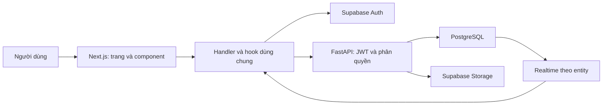

# Tổng quan bố cục và chức năng từng trang

Ngày đối chiếu: 19/10/2026. Báo cáo mô tả mã nguồn hiện có; không thay đổi thiết kế, nghiệp vụ, database hoặc nội dung demo.

## Cách đọc

- **Component**: khối React có thể tái sử dụng, ví dụ `VolunteerWorkspaceFrame`.
- **Thẻ HTML**: phần tử trình duyệt như `<aside>`, `<nav>`, `<main>`.
- **Hàm**: đơn vị xử lý trong code; callback là hàm được truyền vào hook/sự kiện.
- **Handler**: hàm chạy khi bấm nút, nhập liệu hoặc gửi biểu mẫu.
- **API**: điểm giao tiếp giữa giao diện và backend; quyền nằm tại server.

## Sơ đồ hệ thống

## Các lớp bố cục

| Lớp | Nguồn | Trách nhiệm |
|---|---|---|
| Layout gốc | [frontend/app/layout.tsx](D:/WebNhiLun/frontend/app/layout.tsx) | CSS, metadata, LiveDataSync, ThemeSync |
| Khung công khai/portal | [frontend/components/portal/shared.tsx](D:/WebNhiLun/frontend/components/portal/shared.tsx) | PortalShell, header, trạng thái, liên kết theo vai trò |
| Workspace tình nguyện viên | [frontend/components/portal/VolunteerWorkspaceFrame.tsx](D:/WebNhiLun/frontend/components/portal/VolunteerWorkspaceFrame.tsx) | Sidebar, thanh tìm kiếm, tài khoản, thông báo, children |
| Nội dung marketing | [frontend/components/portal/LegacyMarketingPage.tsx](D:/WebNhiLun/frontend/components/portal/LegacyMarketingPage.tsx) | HTML template từ site-content, Stories, modal và tương tác |

## Danh sách trang

| Route | Trang | Báo cáo chi tiết | Entry |
|---|---|---|---|
| `/[...legacy]` | Điều hướng đường dẫn HTML cũ | [Xem bố cục, hàm và API](page-reference/-legacy.md) | [frontend/app/[...legacy]/page.tsx](D:/WebNhiLun/frontend/app/[...legacy]/page.tsx) |
| `/about` | Giới thiệu | [Xem bố cục, hàm và API](page-reference/about.md) | [frontend/app/about/page.tsx](D:/WebNhiLun/frontend/app/about/page.tsx) |
| `/activities/[identifier]` | Chi tiết hoạt động | [Xem bố cục, hàm và API](page-reference/activities-identifier.md) | [frontend/app/activities/[identifier]/page.tsx](D:/WebNhiLun/frontend/app/activities/[identifier]/page.tsx) |
| `/activities` | Danh sách hoạt động | [Xem bố cục, hàm và API](page-reference/activities.md) | [frontend/app/activities/page.tsx](D:/WebNhiLun/frontend/app/activities/page.tsx) |
| `/admin/moderation` | Kiểm duyệt | [Xem bố cục, hàm và API](page-reference/admin-moderation.md) | [frontend/app/admin/moderation/page.tsx](D:/WebNhiLun/frontend/app/admin/moderation/page.tsx) |
| `/admin/stories` | Quản lý Stories | [Xem bố cục, hàm và API](page-reference/admin-stories.md) | [frontend/app/admin/stories/page.tsx](D:/WebNhiLun/frontend/app/admin/stories/page.tsx) |
| `/admin/theme-settings` | Cài đặt giao diện | [Xem bố cục, hàm và API](page-reference/admin-theme-settings.md) | [frontend/app/admin/theme-settings/page.tsx](D:/WebNhiLun/frontend/app/admin/theme-settings/page.tsx) |
| `/auth` | Đăng nhập và đăng ký | [Xem bố cục, hàm và API](page-reference/auth.md) | [frontend/app/auth/page.tsx](D:/WebNhiLun/frontend/app/auth/page.tsx) |
| `/auth/reset` | Đặt lại mật khẩu | [Xem bố cục, hàm và API](page-reference/auth-reset.md) | [frontend/app/auth/reset/page.tsx](D:/WebNhiLun/frontend/app/auth/reset/page.tsx) |
| `/certificates` | Chứng nhận | [Xem bố cục, hàm và API](page-reference/certificates.md) | [frontend/app/certificates/page.tsx](D:/WebNhiLun/frontend/app/certificates/page.tsx) |
| `/certificates/verify` | Xác minh chứng nhận | [Xem bố cục, hàm và API](page-reference/certificates-verify.md) | [frontend/app/certificates/verify/page.tsx](D:/WebNhiLun/frontend/app/certificates/verify/page.tsx) |
| `/dashboard` | Chuyển hướng dashboard | [Xem bố cục, hàm và API](page-reference/dashboard.md) | [frontend/app/dashboard/page.tsx](D:/WebNhiLun/frontend/app/dashboard/page.tsx) |
| `/favorites` | Yêu thích | [Xem bố cục, hàm và API](page-reference/favorites.md) | [frontend/app/favorites/page.tsx](D:/WebNhiLun/frontend/app/favorites/page.tsx) |
| `/forbidden` | Không có quyền | [Xem bố cục, hàm và API](page-reference/forbidden.md) | [frontend/app/forbidden/page.tsx](D:/WebNhiLun/frontend/app/forbidden/page.tsx) |
| `/notifications` | Thông báo | [Xem bố cục, hàm và API](page-reference/notifications.md) | [frontend/app/notifications/page.tsx](D:/WebNhiLun/frontend/app/notifications/page.tsx) |
| `/organizer/create-event` | Tạo hoạt động | [Xem bố cục, hàm và API](page-reference/organizer-create-event.md) | [frontend/app/organizer/create-event/page.tsx](D:/WebNhiLun/frontend/app/organizer/create-event/page.tsx) |
| `/organizer/manage` | Quản lý ban tổ chức | [Xem bố cục, hàm và API](page-reference/organizer-manage.md) | [frontend/app/organizer/manage/page.tsx](D:/WebNhiLun/frontend/app/organizer/manage/page.tsx) |
| `/` | Trang chủ | [Xem bố cục, hàm và API](page-reference/home.md) | [frontend/app/page.tsx](D:/WebNhiLun/frontend/app/page.tsx) |
| `/privacy` | Chính sách riêng tư | [Xem bố cục, hàm và API](page-reference/privacy.md) | [frontend/app/privacy/page.tsx](D:/WebNhiLun/frontend/app/privacy/page.tsx) |
| `/profile` | Hồ sơ cá nhân | [Xem bố cục, hàm và API](page-reference/profile.md) | [frontend/app/profile/page.tsx](D:/WebNhiLun/frontend/app/profile/page.tsx) |
| `/schedule` | Lịch hoạt động | [Xem bố cục, hàm và API](page-reference/schedule.md) | [frontend/app/schedule/page.tsx](D:/WebNhiLun/frontend/app/schedule/page.tsx) |
| `/stories` | Stories | [Xem bố cục, hàm và API](page-reference/stories.md) | [frontend/app/stories/page.tsx](D:/WebNhiLun/frontend/app/stories/page.tsx) |
| `/terms` | Điều khoản | [Xem bố cục, hàm và API](page-reference/terms.md) | [frontend/app/terms/page.tsx](D:/WebNhiLun/frontend/app/terms/page.tsx) |
| `/volunteer/apply/[activityId]` | Đăng ký tham gia | [Xem bố cục, hàm và API](page-reference/volunteer-apply-activityId.md) | [frontend/app/volunteer/apply/[activityId]/page.tsx](D:/WebNhiLun/frontend/app/volunteer/apply/[activityId]/page.tsx) |
| `/volunteer/dashboard` | Dashboard tình nguyện viên | [Xem bố cục, hàm và API](page-reference/volunteer-dashboard.md) | [frontend/app/volunteer/dashboard/page.tsx](D:/WebNhiLun/frontend/app/volunteer/dashboard/page.tsx) |

Route `/auth/callback` là handler xử lý xác thực, không phải trang giao diện. Các query như `/profile?tab=settings` và `/volunteer/dashboard?section=applications` là nhánh trong một trang, không phải route độc lập.

## Ý nghĩa các thẻ thường gặp

| Thẻ | Vai trò |
|---|---|
| `<aside>` | Thanh bên |
| `<nav>` | Điều hướng hoặc tab |
| `<header>` | Phần đầu |
| `<main>` | Nội dung chính |
| `<section>` | Nhóm nội dung |
| `<article>` | Nội dung độc lập |
| `<form>` | Biểu mẫu |
| `<input>` | Ô nhập |
| `<button>` | Nút thao tác |
| `<select>` | Danh sách lựa chọn |
| `<textarea>` | Nhập nhiều dòng |
| `<table>` | Bảng dữ liệu |
| `<ul>` | Danh sách |
| `<li>` | Mục danh sách |
| `
` | Khối bố cục |
| `<h1>` | Tiêu đề chính |
| `<h2>` | Tiêu đề mục |
| `<h3>` | Tiêu đề khối |
| `<a>` | Liên kết |
| `<footer>` | Chân trang |
| `` | Ảnh |
| `<label>` | Nhãn trường |
| `<dialog>` | Hộp thoại |

## Tra cứu bổ sung

- [Danh mục hàm frontend](22-function-catalog.md)
- [API và hàm backend](23-backend-api-reference.md)
- [Tổng hợp tài liệu và kết quả xóa comment](20-documentation-summary.md)

## Bằng chứng và giới hạn

Bằng chứng: import, AST JSX, chữ ký hàm, JSX event handler và lời gọi API trong file được liên kết. Kết quả: có bản đồ route → component → hàm/API. Cách sử dụng: chọn route, theo link đến dòng nguồn rồi đối chiếu endpoint trong tài liệu backend.

Không tìm thấy HTML gốc trong danh sách file nguồn hiện tại; chỉ có CSS legacy, template chuỗi và nội dung được tải qua API. Vì vậy không khẳng định độ giống HTML bằng kiểm kê này. Các file báo cáo cũ được giữ để tra lịch sử.
